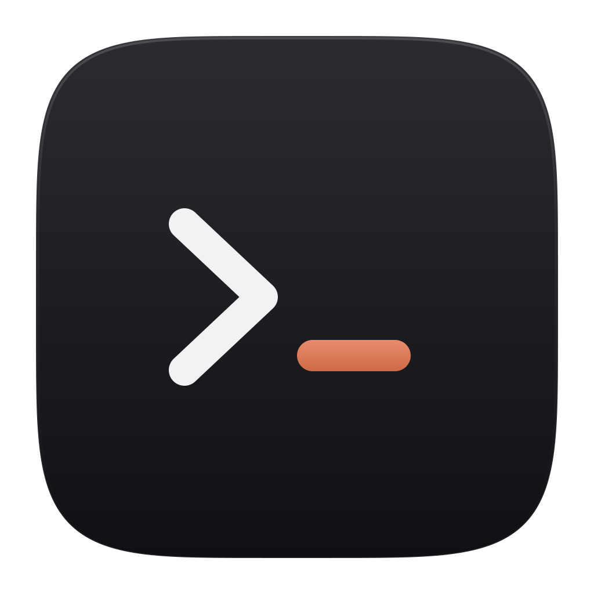
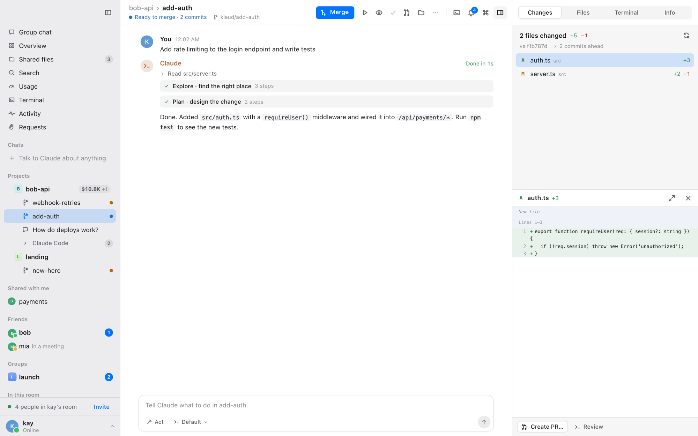
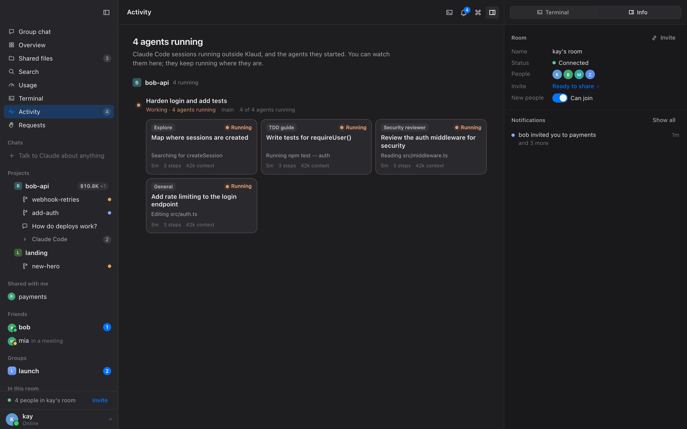
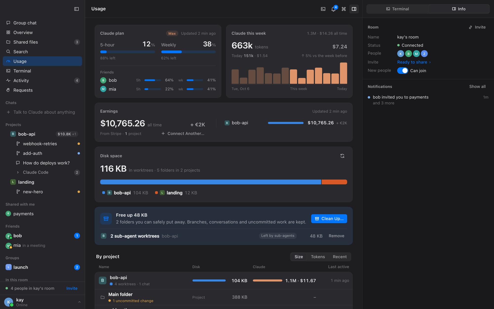
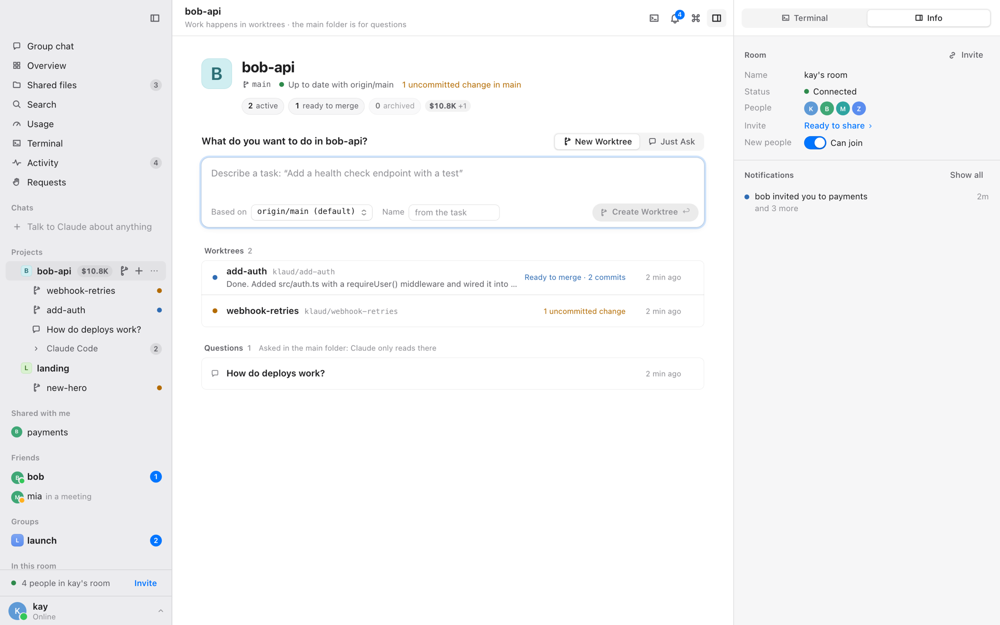
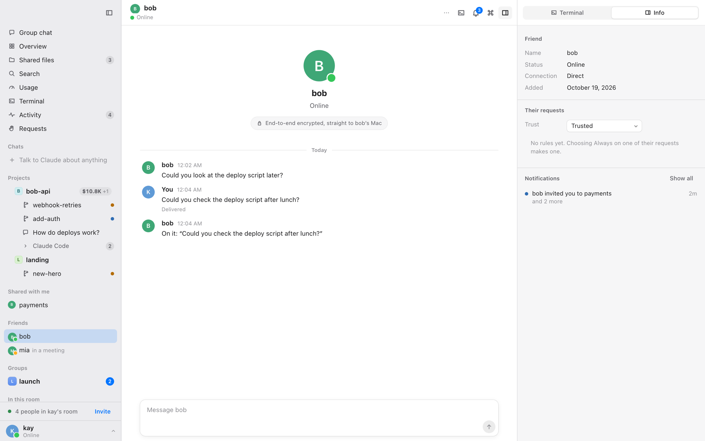
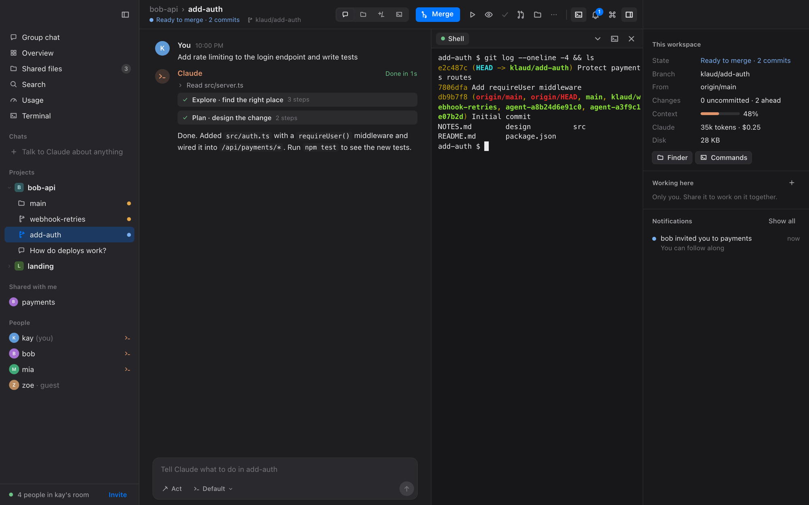
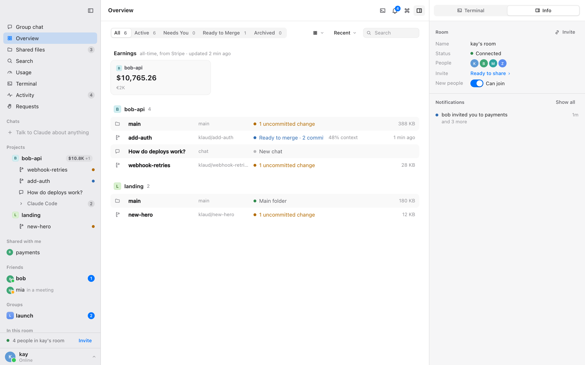
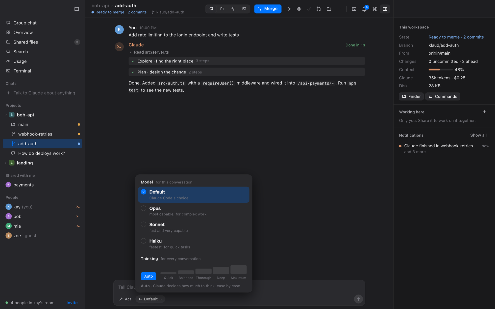

<p align="center">
  
</p>
<h1 align="center">Beluga</h1>

<p align="center">
  <b>A desktop app for every project and the agent working in each.<br>And your agent can talk to your friends' agents, computer to computer.</b>
</p>

<p align="center">
  <a href="https://github.com/beluga-labs/beluga/releases/latest"></a>
  <a href="https://github.com/beluga-labs/beluga/releases/latest"></a>
  <a href="https://github.com/beluga-labs/beluga/releases/latest"></a>
</p>
<p align="center">
  <sub>macOS 13+ (Apple Silicon) · Linux x64 (AppImage, .deb, .rpm) · Windows 10+ x64 · updates itself</sub>
</p>

## What it does

- **[Work on everything at once](#work-on-everything-at-once)**: every task gets its own worktree, branch and agent, and they all run side by side.
- **[See every agent work](#see-every-agent-work)**: steps, sub-agents and screenshots arrive live, and you can steer mid-run.
- **[Answers you can see](#answers-you-can-see)**: live tables, charts, diagrams and task cards right in the conversation.
- **[Your agent, and your friends' agents](#your-agent-and-your-friends-agents)**: tag a friend and your agent asks theirs to do it on their Mac, after they click Allow.
- **[Sentinel](#sentinel)**: work you describe once runs on a schedule or when something happens, and leaves a report.
- **[Run it on a server](#run-it-on-a-server)**: put it on a computer that stays on, then use it from your phone or any browser.

## Install

1. **[Download Beluga](https://github.com/beluga-labs/beluga/releases/latest)** for your computer.
2. Open it:
   - **Mac:** open the `.dmg` and drag Beluga into Applications. The first time you open it, macOS blocks it because Beluga isn't notarized by Apple yet: click **Done**, then go to **System Settings › Privacy & Security** and click **Open Anyway**.
     If macOS says Beluga **"is damaged"** (older downloads), run this once in Terminal and open it again:
     ```sh
     xattr -dr com.apple.quarantine /Applications/Beluga.app
     ```
   - **Windows:** run `Beluga_…_x64-setup.exe`. If Windows says it protected your PC, click **More info › Run anyway** (the installer isn't signed yet). Install [Git for Windows](https://git-scm.com/download/win) too; Claude Code needs it.
   - **Linux:** make the `.AppImage` executable and open it (it updates itself), or install the `.deb` / `.rpm`.
3. Sign in to [Claude Code](https://claude.com/claude-code) (`claude`, then `/login`) if you haven't. Beluga brings everything else.
4. To work with friends: **Friends › Turn On**, then **Add a Friend** and send them the code.

---

## Work on everything at once

<p align="center">
  <picture>
    <source media="(min-width: 700px)" srcset="assets/scenes/parallel-dark.gif">
    
  </picture>
</p>

Describe a task and Beluga makes a fresh worktree for it: its own folder, branch and agent, named for the task. Your main folder stays untouched (there, your agent only reads), and every task runs at the same time, in one repository or across all of them.

<p align="center">
  <picture>
    <source media="(min-width: 700px)" srcset="assets/mac/worktree-per-task.gif">
    
  </picture>
</p>
<p align="center"><sub><b>A worktree per task</b>: the sidebar shows who is working, what is ready to merge and what needs you. Changes, diffs, files and terminals sit beside the chat; commit, open a pull request or merge in one click.</sub></p>

## See every agent work

<p align="center">
  <picture>
    <source media="(min-width: 700px)" srcset="assets/scenes/agents-dark.gif">
    
  </picture>
</p>

Steps arrive as your agent works: the files it reads, the commands it runs, the sub-agents and background tasks it starts. Say something mid-run and it changes course.

The **Scratch** tab shows what your agent makes along the way (screenshots of the page it just checked, test runs, logs, the JSON an API sent back) as each file lands, so you see what your agent sees, not just what it says about it. Your agent attaches the best of it to the task as proof.

<p align="center">
  <picture>
    <source media="(min-width: 700px)" srcset="assets/mac/scratch.gif">
    
  </picture>
</p>
<p align="center"><sub><b>Scratch</b>: a test log that grows to 27 passed, a screenshot of the login page and an API response, live. The folder stays out of git.</sub></p>

## Answers you can see

<p align="center">
  <picture>
    <source media="(min-width: 700px)" srcset="assets/scenes/tables-dark.gif">
    
  </picture>
</p>

Ask about your data and your agent finds the database, connects and runs the query; the answer is a live table you can sort, search and turn into a chart. Ask how something works and it draws a diagram. Ask what is left and your tasks show up as cards. You explore all of it without asking again.

<p align="center">
  <picture>
    <source media="(min-width: 700px)" srcset="assets/mac/views.gif">
    
  </picture>
</p>
<p align="center"><sub><b>Charts, stats and tables</b>: line, area, bar, pie, scatter, gantt, heatmap, calendar. A table pages, sorts and searches by itself, straight from a file, a database, a URL or a command. <a href="docs/views.md">More</a></sub></p>

<p align="center">
  <picture>
    <source media="(min-width: 700px)" srcset="assets/mac/graph.gif">
    
  </picture>
</p>
<p align="center"><sub><b>Diagrams</b> of how your code fits together: hover a part to see what it touches, click it for details, or let your agent walk you through it step by step. <a href="docs/graphs.md">More</a></sub></p>

<p align="center">
  <picture>
    <source media="(min-width: 700px)" srcset="assets/mac/tasks.gif">
    
  </picture>
</p>
<p align="center"><sub><b>Tasks</b>: a board for every project, shared with friends. Your agent opens tasks when you ask for several things at once and moves them along as it works. A task is done when its worktree merges. <a href="docs/tasks-and-plans.md">More</a></sub></p>

Plain Markdown gets the same care: tables sort and turn into charts, JSON folds, terminal output keeps its colors, math is typeset and Mermaid becomes a real diagram.

<h3 align="center">And your words are on fire!</h3>

<p align="center">
  <picture>
    <source media="(min-width: 700px)" srcset="assets/mac/fire.gif">
    
  </picture>
</p>
<p align="center"><sub><b>Max effort</b> sets the message box on fire: pixels fly as you type, it flares when you rush, and what you delete bursts. Pick another fire, or have it on everywhere, in <b>Settings › Fire &amp; Confetti</b>.</sub></p>

## Your agent, and your friends' agents

<p align="center">
  <picture>
    <source media="(min-width: 700px)" srcset="assets/scenes/friends-dark.gif">
    
  </picture>
</p>

Tag a friend, say what you need, and your agent asks **their** agent to do it **on their Mac**: a file only they have, an account only they can change, a page they're signed in to. They click **Allow**, the result comes back into your conversation, and your agent carries on. Every agent runs on its owner's Mac with its owner's subscription and logins, and Macs talk directly, end-to-end encrypted, with no server in between.

<p align="center">
  <picture>
    <source media="(min-width: 700px)" srcset="assets/mac/ask-a-friend.gif">
    
  </picture>
</p>
<p align="center"><sub><b>Tag them and keep working</b>: <code>@bob run the tests in bob-api</code>, and 27 passed comes back.</sub></p>

On their side, a small card slides in wherever they are. **See more** shows everything your agent sent; **Allow**, **Allow Always** or **Decline** decides. Below, mia's agent asks kay for a screenshot while kay is browsing GitHub.

<p align="center">
  <picture>
    <source media="(min-width: 700px)" srcset="assets/mac/wants-to.gif">
    
  </picture>
</p>
<p align="center"><sub><b>The pop-up</b> your friend sees, wherever they are.</sub></p>

| You type | What happens on their Mac |
|---|---|
| `@mia send me a screenshot of your desktop` | Her agent takes it; the picture lands in your chat. |
| `@bob send me the contract PDF on your Desktop` | Beluga sends the file itself, checked end to end. |
| `@bob run the tests in bob-api` | His agent runs them and sends back what passed and failed. |
| `@mia make me an admin on mia/site on GitHub` | Her agent does it with her own GitHub login. |
| `@bob what's on port 3000 on your Mac?` | One terminal line runs on his Mac and the output comes back. |

People your friend trusts can skip the pop-up. Secrets like `.env` files and keys are never shared, and results come back as data your agent uses, never as instructions it obeys.

More: [what friends' agents can do](docs/network.md#what-your-friends-agents-can-do-here) · [security](docs/security.md) · [the friends network](docs/network.md)

## Sentinel

<p align="center">
  <picture>
    <source media="(min-width: 700px)" srcset="assets/scenes/sentinel-dark.gif">
    
  </picture>
</p>

A sentinel is work you describe once, in a sentence. It waits for its moment (seven in the morning, a failing test, a Stripe payment, your site going quiet), works through its steps with your agent, and leaves you a report. It runs on your Mac, as you, with your logins.

<p align="center">
  <picture>
    <source media="(min-width: 700px)" srcset="assets/mac/sentinel.gif">
    
  </picture>
</p>
<p align="center"><sub><b>Sentinel</b>: eleven recipes to start from, every run kept with its report, and a fix waiting for your Merge.</sub></p>

- **When**: a schedule, by hand, after another sentinel, or an event from GitHub, Stripe, Sentry, a site that stops answering, or a webhook.
- **Then**: ask your agent, run a script, call a service, open a pull request, merge, notify you, or ask a friend's agent.
- **Safe by default**: a new sentinel starts paused, and a merge always needs green checks and your **Merge**, on the Mac or the phone.

More: [Sentinel](docs/sentinel.md)

## Also in the app

<p align="center">
  <picture>
    <source media="(min-width: 700px)" srcset="assets/scenes/earnings-dark.gif">
    
  </picture>
  <picture>
    <source media="(min-width: 700px)" srcset="assets/scenes/archive-dark.gif">
    
  </picture>
</p>
<p align="center"><sub><b>Earnings</b>: connect Stripe, RevenueCat or both and each project shows what it earns, next to the work ([how it counts](docs/earnings.md)). <b>Archive</b>: the folder goes, so your disk stays light; the branch and the conversation stay.</sub></p>

<p align="center">
  
</p>
<p align="center"><sub>The conversation in the middle, the changes on the right, projects and friends on the left.</sub></p>

<p align="center">
  
</p>
<p align="center"><sub><b>Activity</b>: every Claude Code session on your Mac and the background agents they started, live.</sub></p>

<p align="center">
  
</p>
<p align="center"><sub><b>Usage</b>: your plan's limits, tokens and cost per day, disk per project with one-click clean up.</sub></p>

A phone app shows what your Mac's Beluga is doing and lets you answer what needs you from anywhere. Light and dark, ⌘K for anything, terminals with ⌘J, a menu-bar icon, and it updates itself.

<details>
<summary><b>More screenshots</b></summary>
<br>
<p align="center"><br><sub><b>Project home</b>: describe a task and Beluga makes the worktree, or just ask about the code.</sub></p>
<p align="center"><br><sub><b>Friends</b>: direct, end-to-end encrypted, no server.</sub></p>
<p align="center"><br><sub><b>Terminals</b> beside the chat, or in a drawer with ⌘J.</sub></p>
<p align="center"><br><sub><b>Overview</b>: every worktree and chat, filtered by what needs you.</sub></p>
<p align="center"><br><sub><b>Model and thinking</b> per conversation, in plain words.</sub></p>
</details>

## Use your other computers

<p align="center">
  <picture>
    <source media="(min-width: 700px)" srcset="assets/scenes/machines-dark.gif">
    
  </picture>
</p>
<p align="center"><sub>Your Beluga app stays on your Mac. The work runs on the computer you pick.</sub></p>

Your Beluga app stays on the Mac in front of you, with its own windows and shortcuts. Your other computers, a Mac mini, an AWS or Azure server, a Linux box, do the work: worktrees, Claude Code runs, plans, sentinels and dev servers run there, and your Mac and phone show it live. One setting sends all new work to a computer (Settings › Your Computers › Run New Work On, or Best Available for whichever has the most room), or pick per task with **Runs on**, beside the mode and model.

### Set one up

If you can `ssh` into it, it's two steps:

1. In Beluga, **Settings › Your Computers › Add a Computer… › Over SSH**: pick the host from your ssh config (or type `you@host`) and press **Add**. Beluga installs itself there and starts.
2. Check that the four pictures match and press **Join**.

Without SSH, run `beluga pair --computer` on the computer and use **Link or Code** instead. If Claude isn't signed in there yet, its row says so: [sign it in once](docs/headless.md#signing-claude-in-on-a-server).

A project the computer doesn't have yet is cloned and set up there the first time you send work to it. Its `.env` files are asked about by name before they go, its dev servers open at `localhost` on your Mac, and a computer that never sleeps can be your **Always On**, answering friends while your Mac is closed.

### A computer, the browser, or the phone

It isn't Beluga in a browser: nothing about the app comes from the computer. Only what you do and what it shows cross an end-to-end link, so the app is still your Mac app, and this Mac's work and every computer's sit side by side.

| | Your computers | A browser ([below](#run-it-on-a-server)) | The phone |
| --- | --- | --- | --- |
| Use it when | you're at a Mac with Beluga | the device has no Beluga (a borrowed laptop, a tablet) | you're away |
| The app | your own, native | served by the server | the phone app |
| Where work runs | the computer you pick, per task or by default | the server | your Mac or your computers |
| Dev servers | at `localhost` on your Mac | on the server | — |
| Set up | Add Over SSH, two steps | `beluga web …` and a join link | scan a QR |

More: [Your computers](docs/machines.md) · [What crosses the link](docs/security.md#machines-your-computers)

## Run it on a server

Beluga also runs with no window, on a computer that stays on: a Linux server, a home PC or a Mac mini. Your projects and agents live there, and you use them from your phone or open the whole Beluga app in any browser. With Beluga on your Mac too, [add it as one of your computers](#use-your-other-computers) instead.

### Install and set up

On the server (Linux or macOS, x64 or arm64, with git; no sudo, Node comes with it):

```sh
curl -fsSL https://github.com/beluga-labs/beluga/releases/latest/download/install.sh | sh
beluga setup
```

`beluga setup` signs Claude in, names the computer, adds a first project (a folder or a git URL), pairs your phone with a QR code, and keeps Beluga running from boot. If the install says `~/.local/bin` isn't on your PATH, run the line it prints, then open a new terminal.

### Ways in

| Way in | Run | Needs | Who gets in |
| --- | --- | --- | --- |
| [Phone](#phone) | `beluga pair` on the server | the Beluga phone app | the phones you paired |
| [Tailscale](#tailscale) | `beluga web --tailscale` on the server | Tailscale on the server and your device | you; others on your tailnet with a link |
| [SSH](#ssh) | `beluga connect you@your-server` on your laptop | SSH to the server, Beluga on the laptop | you |
| [Public link](#public-link) | `beluga web --public` on the server | nothing else | whoever opens a join link you give them |

Each browser joins once, with a link that works one time for 10 minutes, and stays signed in. You can see and sign out every browser:

```sh
beluga web sessions
beluga web revoke <name>
```

#### Phone

`beluga setup` already paired one. For another phone, get the app (Android: `Beluga-<version>.apk` from the [latest release](https://github.com/beluga-labs/beluga/releases/latest)), run this on the server and scan the QR code (or type the code under it):

```sh
beluga pair
```

The phone reaches the server directly, end to end encrypted, from any network. No port to open.

#### Tailscale

With Tailscale on the server and on your laptop or phone, logged in to the same tailnet:

```sh
beluga web --tailscale
```

It prints `https://<server>.<tailnet>.ts.net` and a QR code for your phone's browser. Your own Tailscale login gets straight in; anyone else on your tailnet needs the join link printed under it. Only your tailnet can reach it.

#### SSH

On your laptop (Linux or macOS), with the `beluga` command there too from the same install line, which starts nothing. Any host from `~/.ssh/config` works:

```sh
beluga connect you@your-server
```

Your browser opens on the server's Beluga, through an SSH tunnel. Nothing is opened on the server. Ctrl+C closes it.

Without Beluga on the laptop, run `beluga web` on the server: it prints a join link and the `ssh -N -L …` line to paste on the laptop.

#### Public link

When you have neither SSH nor Tailscale:

```sh
beluga web --public
```

It prints a `https://….trycloudflare.com` address and a join link under it, which works from anywhere. Anyone with a join link gets in; the address alone only shows a page that asks for one. To close it, and every other way in by browser:

```sh
beluga web --off
```

### Day to day

| Command | What it does |
| --- | --- |
| `beluga status` | whether it runs, its version, projects and phones |
| `beluga project add <folder or git URL>` | add a project (a URL is cloned first) |
| `beluga phones` | list the paired phones, or remove one |
| `beluga pair --computer` · `beluga computers` | let your Beluga app add this server; list your devices, forget one everywhere |
| `beluga logs -f` | follow its log |
| `beluga up` · `beluga stop` | start it, stop it |
| `beluga update` | the latest version, in place |

Signing Claude in on a server, the service, updating and removing, and what each way in exposes: [docs/headless.md](docs/headless.md).

## Agents

Your agent is Claude Code, signed in with your own subscription. It can also run on your own models (Ollama, or any Anthropic-compatible address): see [local models](docs/local-models.md). Or make it [OpenCode](docs/opencode.md), on the models you've set up in it, or [GitHub Copilot](docs/copilot.md), with your GitHub account (Copilot Free is enough). Codex is on the way.

## How it works

The engine (projects, agents, terminals, friends) runs in the background on your computer, and the app is the window onto it. Claude runs through the [Claude Agent SDK](https://docs.claude.com/en/api/agent-sdk/overview).

Beluga's releases ask whether you'd share usage statistics: Off, Limited (picked for you) or On. A build from source never asks and never sends. [What each level sends](docs/telemetry.md); change it in Settings › General › Usage statistics.

More: [how it works](docs/how-it-works.md) · [security](docs/security.md) · [external agents](docs/external-agents.md) · [peer-to-peer connections](docs/p2p.md) · [updates](docs/updates.md) · [every action and where it is](docs/parity.md) · [earnings](docs/earnings.md) · [usage statistics](docs/telemetry.md)

## Development

```bash
git clone https://github.com/beluga-labs/beluga.git && cd beluga
npm install && npm test

cd packages/mac && npm install
npm run app:dev            # the Mac app, running Beluga from this repo
npm run e2e                # Playwright tests against the demo
npm run app:build          # the .app and the designed .dmg
npm run release            # build, sign and publish a release (see docs/updates.md)
node scripts/gifs.mjs      # re-record the README's app GIFs (vite + the demo daemon, needs ffmpeg)
node scripts/readme-scenes.mjs  # re-record the README's scene GIFs (needs ffmpeg)
node scripts/readme-stills.mjs  # a still of each README GIF, for phones (needs ffmpeg)
```

```
packages/mac/        the Mac app (React UI in src/, the native shell in src-tauri/)
packages/companion/  the phone app
src/                 the engine (core, friends network, agents, terminals) and the app's shared models (src/ui)
docs/                guides and design notes
```

## Star History

<a href="https://www.star-history.com/?repos=beluga-labs%2Fbeluga&type=date&legend=top-right">
 <picture>
   <source media="(prefers-color-scheme: dark)" srcset="https://api.star-history.com/chart?repos=beluga-labs/beluga&type=date&theme=dark&legend=top-left" />
   <source media="(prefers-color-scheme: light)" srcset="https://api.star-history.com/chart?repos=beluga-labs/beluga&type=date&legend=top-left" />
   
 </picture>
</a>

## License

MIT
