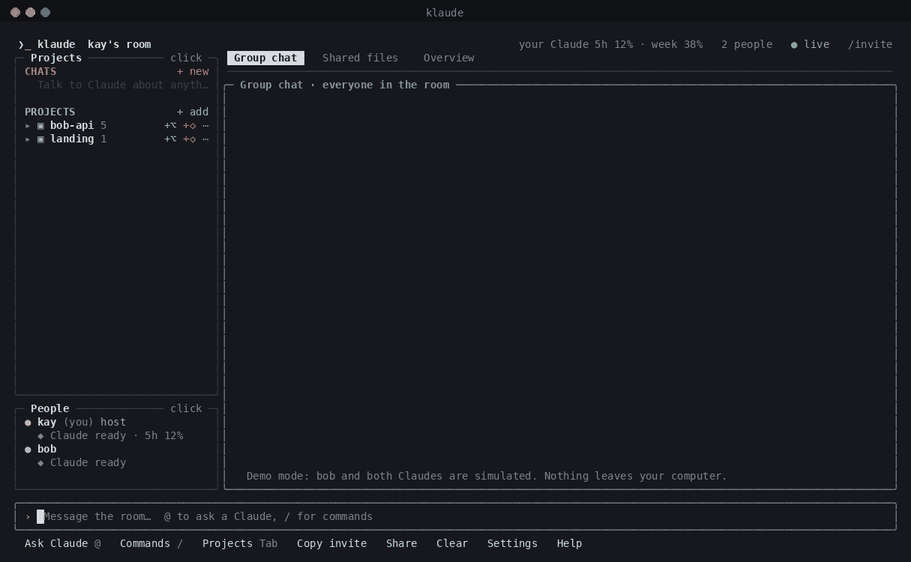
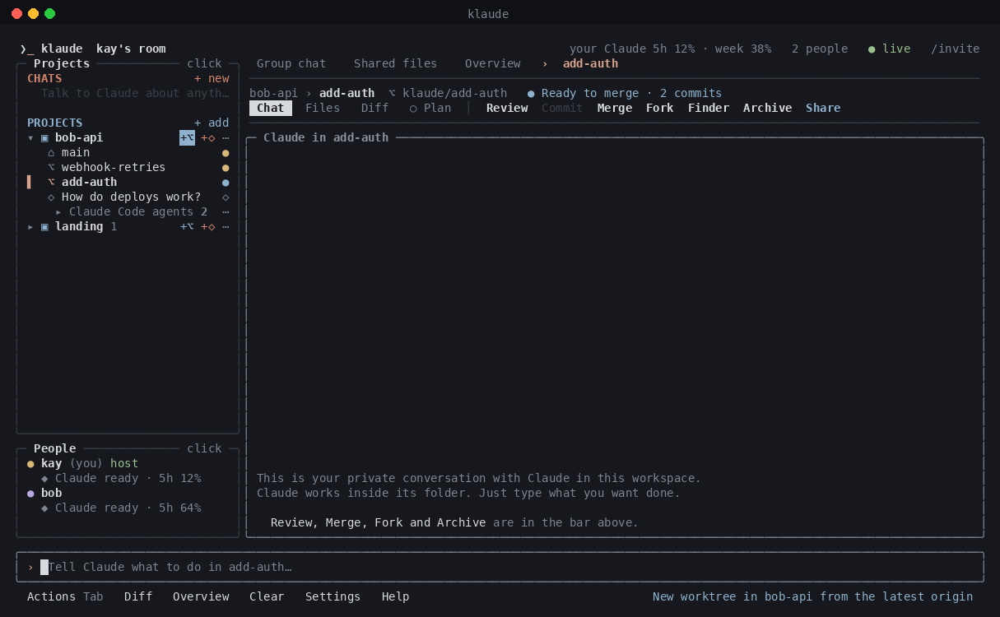
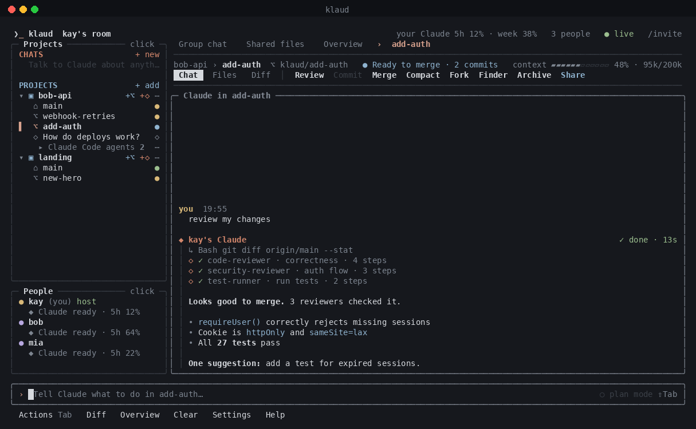
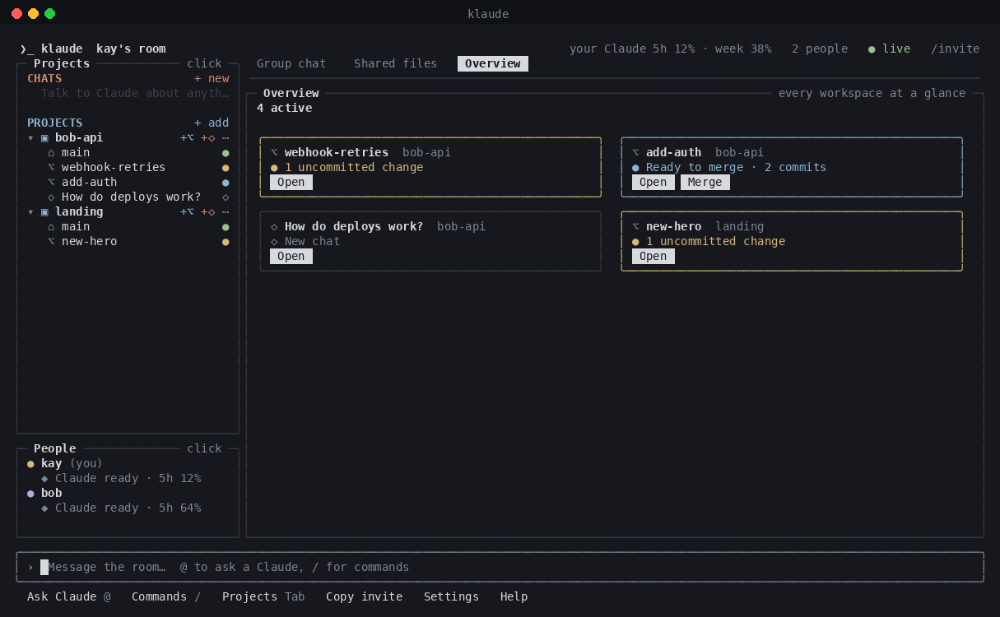
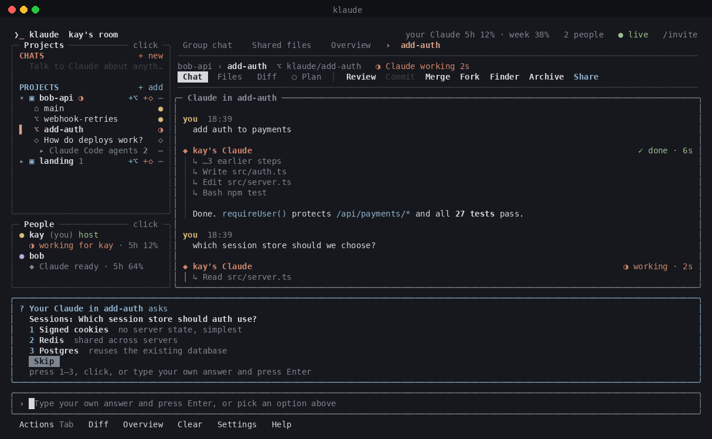
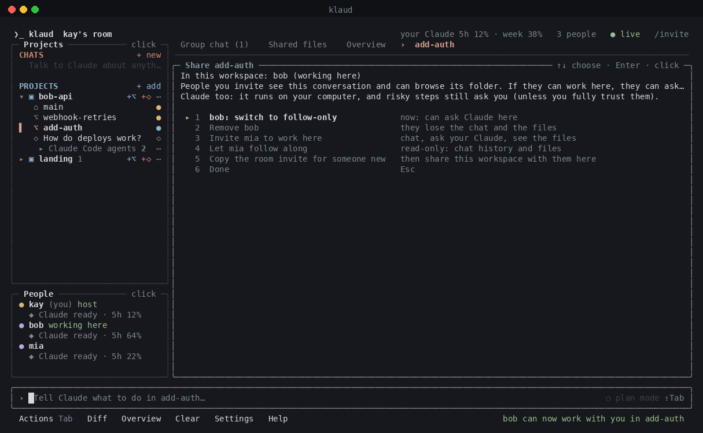
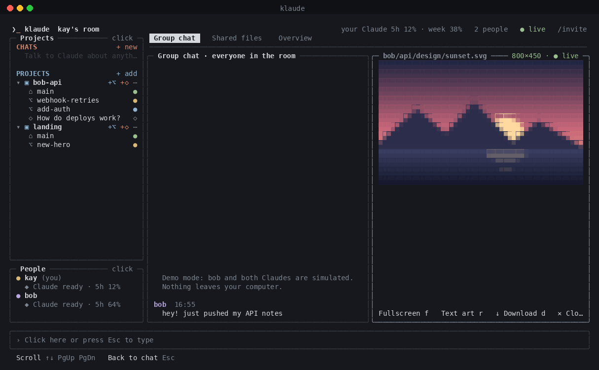
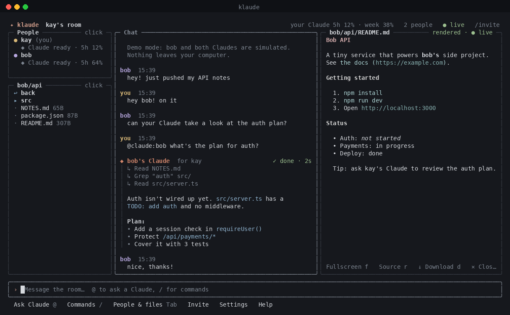
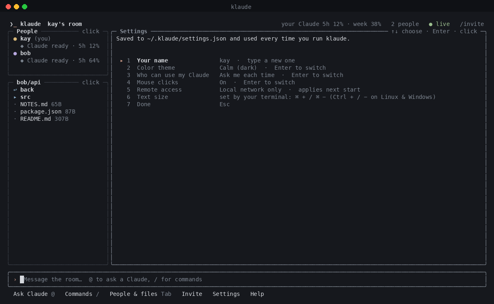

<p align="center">
  <picture>
    <source media="(prefers-color-scheme: dark)" srcset="assets/banner-dark.svg">
    
  </picture>
</p>

<p align="center">
  <a href="#quick-start"><b>Quick start</b></a> ·
  <a href="#what-you-can-do"><b>Features</b></a> ·
  <a href="#a-quick-tour"><b>Tour</b></a> ·
  <a href="#how-it-works"><b>How it works</b></a> ·
  <a href="#security"><b>Security</b></a>
</p>

<p align="center">
  
  <br><sub>Recorded with <code>klaude demo</code> (the friend and the Claude replies are simulated)</sub>
</p>

klaude is a home for all your projects and the Claude working in them. Spin up a worktree per task, watch every Claude at a glance, and review and merge without leaving the terminal. When you want company, invite friends: everyone brings their own Claude.

## What you can do

| | |
|---|---|
| 🗂️ **Every project, one place** | klaude finds the git projects on your computer. Add a single project or a whole folder of them, sort them into groups, hide the rest. |
| 🌿 **A worktree per task** | Click **+⌥**, describe the task, and Haiku names the worktree from it. It's created from the latest `origin` with its own Claude conversation, and your `.env` files come along. |
| 🔭 **See everything at a glance** | The Overview shows each workspace in plain words: *Claude is working*, *ready to merge*, *merge conflict*. |
| 🧩 **Sub-agents, visualized** | When Claude fans out to sub-agents or background tasks, they nest under its card with live progress. |
| ✅ **Review, merge, fork, archive** | **Review** runs a thorough check (bugs, security, tests, quality). **Merge** explains itself, and conflicts get a *Solve conflict* button. |
| 🗺️ **Plan first, answer with a click** | Turn on **Plan** and Claude proposes a plan to approve before it changes anything. When Claude asks a question, you get clickable options. |
| 🤝 **Work together** | Invite a friend into one workspace: they see the conversation and files, and can ask your Claude there. Remove them any time. |
| 💬 **Friends and their Claude** | A group chat with friends. `@claude:bob` runs on **bob's** computer with **bob's** subscription. |
| 🖼️ **Images in the terminal** | Open PNG, JPEG, GIF and SVG files, drawn in truecolor half-blocks or as text art. |
| 🔒 **Private by default** | Solo until you click Invite. End-to-end encrypted, and you decide who may use your Claude and where. |

## Quick start

```bash
git clone https://github.com/kayraucklnc/klaude.git && cd klaude
npm install && npm run build && npm link
klaude
```

You need Node 20+ and [Claude Code](https://claude.com/claude-code) signed in (`claude`, then `/login`).

- **`klaude`** opens your projects. Nothing is shared and no tunnel is opened until you click **Invite**.
- **`klaude demo`** lets you look around with a pretend friend and simulated replies.
- **`klaude update`** gets the latest version (or `klaude update --check` to just look).

To bring a friend in, click **Invite** (or run `klaude --invite`) and send them the link. They run `klaude join`.

## A quick tour

<table>
  <tr>
    <td width="50%"><br><b>Projects.</b> Each project lists its worktrees and chats. Hover any button to see what it does.</td>
    <td width="50%"><br><b>Sub-agents.</b> A review fans out to three reviewers, live.</td>
  </tr>
  <tr>
    <td><br><b>Workspaces.</b> Chat, Files and Diff, plus Review, Merge, Fork, Finder and Archive. Buttons that can't act are dimmed and say why.</td>
    <td><br><b>Overview.</b> Every workspace, one plain-language state each.</td>
  </tr>
  <tr>
    <td><br><b>Plan first.</b> Claude looks around, then asks you to approve its plan.</td>
    <td><br><b>Claude asks, you click.</b> Pick an option, press its number, or type your own answer.</td>
  </tr>
  <tr>
    <td><br><b>Work together.</b> Invite someone into a workspace, switch them to follow-only, or remove them.</td>
    <td><br><b>Images.</b> A friend's SVG, drawn right in the viewer.</td>
  </tr>
  <tr>
    <td><br><b>Friends' Claude.</b> Ask anyone's Claude: live steps, then a clear answer.</td>
  <tr>
    <td><br><b>Settings.</b> Name, theme, text size, approvals, sharing, mouse and remote access.</td>
  </tr>
</table>

Everything is clickable, and the bar at the bottom always says what you can do next. There are no shortcuts to memorize.

---

## Using klaude

### Projects and workspaces

- **CHATS** are conversations with Claude that aren't tied to a project. **+ new** opens an empty chat in the folder you started klaude in. Your first message creates it, and Esc cancels.
- **PROJECTS** are your git repos. Each project row has three buttons:
  - **+⌥** opens a new worktree: describe the task, and a small model (Haiku, on your own login) names it. It's created from the latest `origin` under `~/.klaude/workspaces/<project>/<name>`, and Claude starts right away.
  - **+◇** opens a new chat in the project folder.
  - **⋯** moves the project to a group, hides it, or opens it in Finder.
- **Inside a workspace**, the top bar has (Tab walks through every button, Enter presses it):
  - **Chat**, **Files** and **Diff** views.
  - **Review**: a thorough check by sub-agents covering correctness, security, tests and quality, then a verdict.
  - **Commit** and **Merge**: merging into the main folder. A conflict shows a red banner and a **Solve conflict** button that asks Claude to fix it.
  - **Compact**: summarizes the conversation when the context meter fills up.
  - **Fork**: a new worktree that keeps the conversation.
  - **Finder**: opens the folder.
  - **Archive**: keeps the conversation, removes the worktree. Restore it any time from **Archived**.
  - **Share**: invite people from the room to work here or follow along, and remove them any time.
- **Worktrees from other tools** stay out of the way. The ones Claude Code sub-agents create (`.claude/worktrees/agent-*`) fold into **Claude Code agents**, where **⋯** removes the finished ones (branches are kept). Other tools' worktrees fold into **Other worktrees**.
- **Env files**: `.env*` files (and `.ssh` / `.aws` folders inside the project) are copied into new worktrees. When you archive or delete one, klaude shows which keys changed and offers to copy them back to main.

### On your own

klaude starts solo. The **Chat** tab is you and your Claude, so just type, no `@claude` needed. Start a message with `@add-auth` (Tab completes) to send it to the Claude working in that worktree or project.

Worktrees made by other tools (Conductor, Claude Code) show their latest Claude Code conversation when you open them, and Claude continues it. The People panel appears once someone joins.

### Working with people

- **Invite** opens a secure link and copies it. Your friend runs `klaude join`.
- **Click a person** to:
  - ask their Claude;
  - invite them into one of your workspaces;
  - share a folder with just them;
  - follow them;
  - set how far their requests may reach;
  - fully trust them.
- **The host** can also:
  - **remove someone** (they're disconnected, and the invite link changes so the old one stops working);
  - **make a new invite link**;
  - **close the room** to new people.
- **Shared workspaces** appear under **SHARED WITH ME**. If you can work there, your messages go to the owner's Claude, on their computer.
- **Share a folder** from **Shared files** (or the person menu). Pick this folder, a project or any path, then choose everyone or one person, and read-only or editable. Secrets are never shared.
- **Clear** a conversation: just for you, for everyone (the host, in the group chat), or with a fresh Claude conversation (in a workspace).

### Claude asks you

When Claude needs a decision, a card appears above the box you type in:
- **A question**: click an option, press its number, or type your own answer and press Enter. **Skip** lets Claude decide.
- **A plan**: press **Shift+Tab** in a conversation to turn on plan mode (shown on the right of the input box). Claude then investigates read-only and proposes a plan: **Approve plan** lets it start, or type what to change.

Questions go to whoever asked Claude, even when it's a friend's Claude on their computer. Unanswered questions time out after 5 minutes, so nothing waits forever.

### Talking

| Type | What happens |
|---|---|
| `fix the failing test` (in a workspace) | your Claude, working in that workspace |
| `hey all` (in the group chat) | message everyone |
| `@claude fix the failing test` | your Claude, on your computer |
| `@claude:bob how does auth work?` | bob's Claude, on bob's computer, after bob approves |
| `@claudes review this plan` | every Claude in the room at once |

- **Enter** sends. If Claude is busy, the message waits in line.
- **Option+Enter** (or **Ctrl+Enter**) interrupts and sends right away.
- Type `@` or `/` to get suggestions, and scroll through all of them with ↑ ↓.

### Commands

| Command | |
|---|---|
| `/new name` · `/chat` · `/fork` · `/archive` | create, fork or archive workspaces |
| `/plan on\|off` | plan first in this conversation |
| `/review` · `/commit` · `/merge` · `/compact` · `/finder` | act on the current workspace |
| `/overview` · `/room` | the overview, or back to the group chat |
| `/invite` | open remote access and copy an invite link |
| `/open bob:api/README.md` · `/get bob:api/data.csv` | open or download a shared file (autocompletes) |
| `/follow bob` · `/unfollow` | follow bob and bob's Claude |
| `/settings` · `/theme` · `/zoom in` · `/name` | settings and quick changes |
| `/policy ask\|auto\|deny` · `/trust bob` | who can use your Claude |
| `/share ~/notes` · `/unshare notes` | share a folder (or use **+ Share a folder**) |
| `/remove bob` · `/newlink` · `/lock on\|off` | host: remove someone, replace the invite link, close the room |
| `/stop` · `/copy` · `/people` · `/clear` · `/help` · `/quit` | |

### Keys (all optional, since everything is also clickable)

| Key | |
|---|---|
| `Enter` · `Option+Enter` | send (queued while Claude works) · interrupt and send now |
| `Tab` | jump between areas: chat, the top bar, projects, people (and files or the diff when shown) |
| `Enter` / `Esc` (on an area) | go inside it (then `Tab` or arrows move between its items) / come back out |
| `Shift+Tab` (in the chat) | switch plan mode: Claude plans first and asks you to approve |
| `1`–`4` | pick an option on Claude's question card |
| `@` | `Option+Q` (Turkish), `Option+L` (German) and `Option+2` (Spanish) work even when your terminal sends Option as Meta |
| `Esc` | back to typing, or cancel a new chat |
| `↑ ↓` · `PgUp PgDn` | history or suggestions · scroll |
| `Option+↑` / `Option+↓` | bigger or smaller text (works on every keyboard layout) |
| `f` · `r` · `d` (in the viewer) | fullscreen · source/formatted (or color/text art) · download |
| `Ctrl+Y` · `Ctrl+N` · `Ctrl+T` | allow · deny · always allow this person |
| `Ctrl+C` twice | quit |

### Settings

Your choices are saved in `~/.klaude/settings.json`, so plain `klaude` always starts the way you like it. Open **Settings** from the bottom bar or with `/settings`:

- **Name**: what friends see
- **Color theme**: Calm (dark), Light terminal, High contrast, Monochrome
- **Text size**: bigger or smaller from inside klaude (Terminal, iTerm2, Warp and kitty)
- **Approvals**: whether your own Claude asks before risky steps, and who else may use it (ask, everyone, nobody)
- **Mouse**: turn it off to get your terminal's native text selection back
- **Remote access**: Cloudflare (default), ngrok, or local network only

### Command line

```
klaude                           your projects, with your saved settings (solo)
klaude --invite                  also open remote access and copy an invite
klaude join [invite]             join a friend (reads the invite from your clipboard)
klaude demo                      try everything with a pretend friend
klaude view <image> [--ascii]    show a PNG, JPEG, GIF or SVG in the terminal
klaude update [--check]          get the latest klaude, or just check

  -n, --name <name>        display name (remembered)
  -s, --share <spec>       share a folder: [name=]path[:rw], repeatable
      --no-agent           don't offer your Claude
      --policy <p>         ask | auto | deny
      --tunnel <kind>      auto | cloudflared | ngrok | none
      --no-mouse           keyboard only
      --model <id>         model for your Claude
```

## How it works

```
 your computer                                       bob's computer
┌──────────────────────────────┐                   ┌──────────────────────────────┐
│ klaude                        │   encrypted       │ klaude                        │
│  projects · chat · files      │◄─── frames ──────►│  projects · chat · files      │
│  your Claude (your login)     │  via Cloudflare   │  bob's Claude (bob's login)   │
│  room hub (relay)             │                   │                               │
└──────────────────────────────┘                   └──────────────────────────────┘
```

- **Each Claude runs at home.** The [Claude Agent SDK](https://docs.claude.com/en/api/agent-sdk/overview) drives each person's own Claude Code, with their own subscription and permissions. Workspace conversations stay on your computer.
- **Room hub.** When you invite people, the host runs a small relay. Friends connect through a free Cloudflare quick tunnel. The topology is a star through the host, not a mesh. The relay checks the invite secret, forwards messages, and keeps a short history for latecomers.
- **End-to-end encryption.** Every frame is sealed with AES-256-GCM, using keys derived from the invite secret with HKDF. Neither the tunnel nor the relay can read or forge messages.
- **Limits.**
  - Up to 16 people per room and 120 messages per second per connection.
  - Messages up to 1 MB. Files are sent in 256 KB encrypted chunks, up to 200 MB.
  - Cloudflare quick tunnels have no uptime guarantee. Use ngrok or your own network if you need one.
- **Images** are decoded in a background thread and shrunk before they're drawn, so big photos never freeze the screen.

## Security

Inviting someone exposes your Claude, with your permissions, to the internet. klaude is built around that:

- **Solo by default.** No tunnel and no invite exist until you click Invite.
- **The invite is the key.** Anyone with the link can join, so share it privately. The host can **remove** someone, **replace the link** (the old one stops working; people already in stay), or **close the room** to newcomers.
- **Identities can't be borrowed.** Everyone signs in with their own key, and their id comes from it, so nobody (not even someone with the invite) can pose as the host or as another member.
- **Workspaces are private** until you share one. People you invite to work there can ask your Claude in that workspace. Risky steps still ask you unless you fully trust them, and viewers can only watch.
- **You approve requests.** A friend can't run your Claude unless you allow it: each time, for one person, or for everyone. **Fully trust** someone to skip approvals for them. Unanswered approvals are declined after 5 minutes, so nobody waits forever.
- **You set the reach.** Per friend, choose *shared folders only* (the default) or *whole computer*. Risky steps (shell commands, web requests, edits outside a `:rw` folder) always ask, even ones Claude Code would normally auto-approve.
- **Secrets stay put.** `.env` files, keys, `.ssh`, `.aws` and similar are never shared or readable by friends' requests.
- **Untrusted files are handled carefully.** Images from friends are size-checked before decoding, and SVGs can't load files from your disk.
- **Be aware:** a friend's message can try to talk your Claude into things (prompt injection). Keep approvals on for people you don't fully trust.

## Development

```bash
npm install
npm run dev -- demo        # run from source
npm test                   # 280+ unit and multi-peer integration tests
npm run typecheck
```

## Roadmap

- Create a worktree on a friend's laptop
- Show a shared workspace's diff to the people in it
- True peer-to-peer connections (WebRTC) with per-friend invites

## License

MIT
