<p align="center">
  <picture>
    <source media="(prefers-color-scheme: dark)" srcset="assets/banner-dark.svg">
    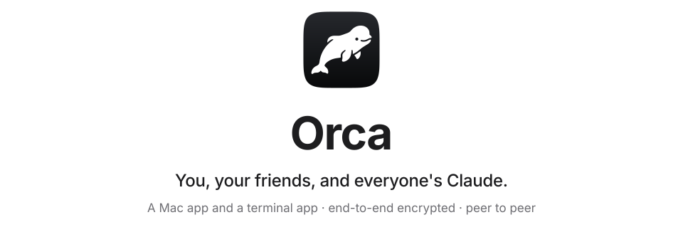
  </picture>
</p>

<p align="center">
  <b>A desktop app for every project and the agent working in each.<br>And your agent can talk to your friends' agents, computer to computer.</b>
</p>

<p align="center">
  <a href="https://github.com/kayraucklnc/beluga/releases/latest"></a>
  <a href="https://github.com/kayraucklnc/beluga/releases/latest"></a>
  <a href="https://github.com/kayraucklnc/beluga/releases/latest"></a>
</p>
<p align="center">
  <sub>macOS 13+ (Apple Silicon) · Linux x64 (AppImage, .deb, .rpm) · Windows 10+ x64 · updates itself</sub>
</p>

---

## 📊 Your agent shows you, not just tells you

Ask about data and the answer comes with live charts, stat tiles and tables. Ask how something works and your agent draws it. Ask what's left and your tasks show up as cards. All of it sits right in the conversation, and you can click, sort and explore it without asking your agent again.

<p align="center">
  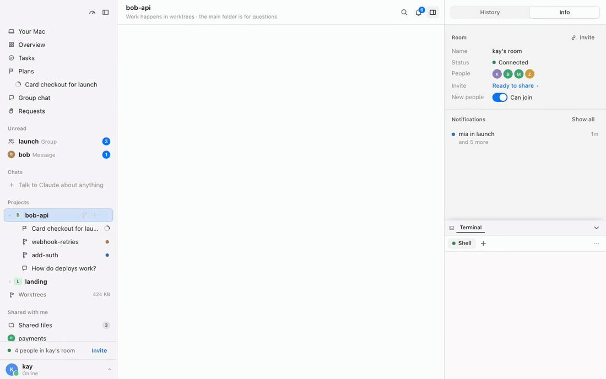
</p>
<p align="center"><sub>📈 <b>Charts, stats and tables</b>: line, area, bar, pie, scatter, gantt, heatmap, calendar. A table pages, sorts and searches by itself, straight from a file, a database, a URL or a command. <a href="docs/views.md">More</a></sub></p>

<p align="center">
  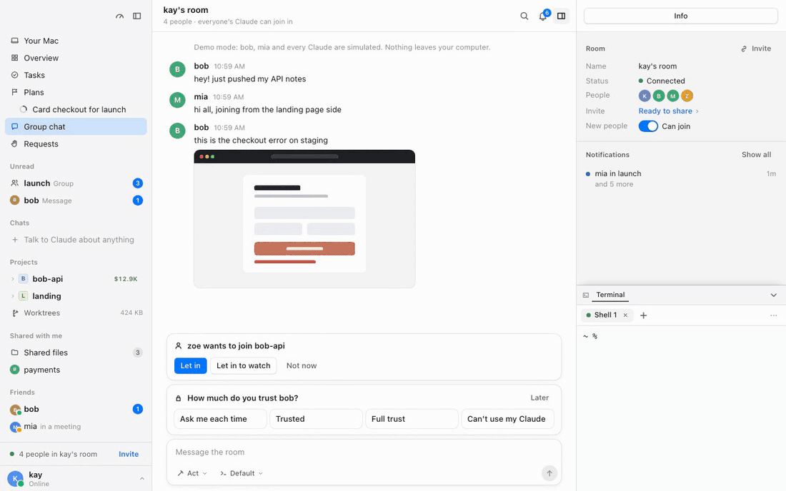
</p>
<p align="center"><sub>🗺️ <b>Diagrams</b> of how your code fits together: hover a part to see what it touches, click it for details, or let your agent walk you through it step by step (<code>/visualize</code>). <a href="docs/graphs.md">More</a></sub></p>

<p align="center">
  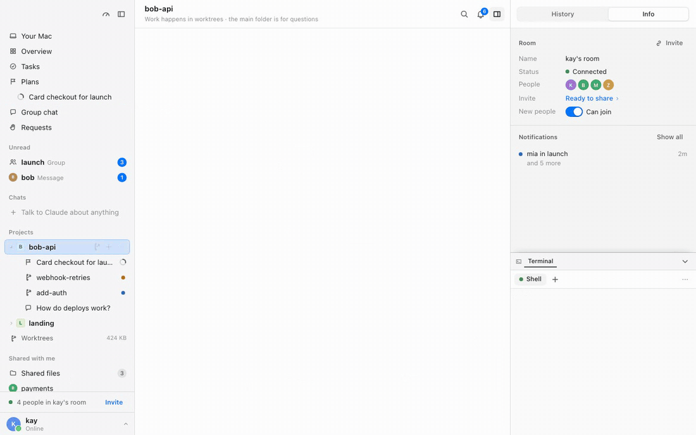
</p>
<p align="center"><sub>✅ <b>Tasks</b>: a board for every project, shared with friends. Your agent opens tasks when you ask for several things at once, moves them along as it works, and shows them in its answers as live cards. A task is done when its worktree merges. <a href="docs/tasks-and-plans.md">More</a></sub></p>

Plain Markdown gets the same treatment: tables sort and turn into charts, JSON folds, terminal output keeps its colors, math is typeset and Mermaid becomes a real diagram.

---

## 🤝 Your agent, talking to your friends' agents

Tag a friend in a message, say what you need, and your agent asks **their** agent to do it **on their Mac**. They get a small pop-up, click **Allow**, and the answer comes back into your conversation. No server in between, no shared accounts: every agent runs on its owner's Mac, with its owner's subscription and logins.

<p align="center">
  
</p>

### 💬 Tag them, and keep working

Type `@` and pick from the list: a friend (`@bob`), a project (`@bob-api`), a folder or a file in this worktree (`@src/auth.ts`). Whatever names something real turns into a pill, in the box as you type and in the conversation, where a click opens it. Tag a friend and your agent finds them, asks their agent, waits, and carries on with the answer (results with data come back as a table).

<p align="center">
  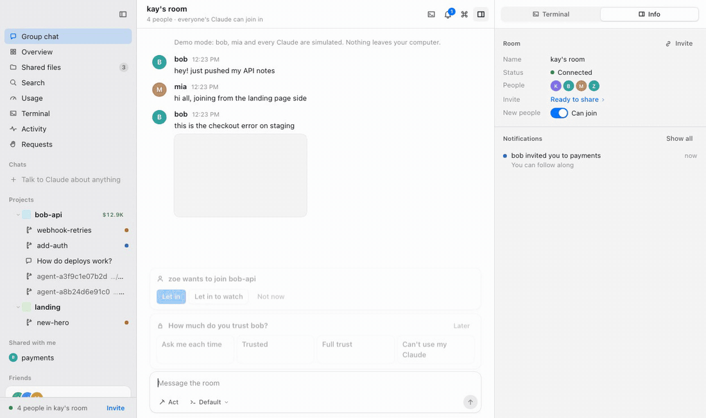
</p>

### 🔔 On their side: a pop-up, wherever they are

Your friend is busy doing something else, browsing GitHub in Chrome, say. A small card slides in at the top of their screen with a few words of what you want. **See more** shows everything your agent sent before they decide. Below, mia's agent asks kay for a screenshot while kay is on the web.

<p align="center">
  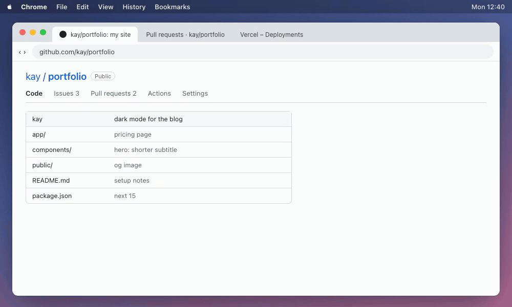
</p>

| Button | What happens |
|---|---|
| ✅ **Allow** | Their agent does it this once. |
| ♾️ **Allow Always** | Requests like this one from you (same kind, same project or command) run without asking from now on. They can change it in Settings › People & access. |
| ✋ **Decline** | You hear "declined", and your agent won't try to get around it. |
| 🔎 **See more** | The full request, what it needs (screen, files, commands…), where it runs and what goes back. |

Trust someone completely? Mark them **Trusted** or **Full trust** and their requests just happen, behind the scenes (you get a quiet notice).

### ✨ Things you can ask

| You type | What happens on their Mac |
|---|---|
| 📸 `@mia send me a screenshot of your desktop` | Her agent takes it; the picture lands in your chat. |
| 📁 `@bob send me the contract PDF on your Desktop` | Beluga sends the file itself (big files come in pieces, checked end to end). |
| 🧪 `@bob run the tests in bob-api` | His agent runs them in his project and sends back passed / failed / skipped. |
| 🔑 `@mia make me an admin on mia/site on GitHub` | Her agent does it with **her** GitHub login (`gh`), after she allows it. |
| 🖥️ `@ali what macOS, chip and free disk does your Mac have?` | Device info: versions, memory, disk, battery. Never serial numbers. |
| ⚡ `@bob what's on port 3000 on your Mac?` | Anything that's one terminal line runs straight on his Mac (`lsof -i :3000`) and the output comes back to you. |

Their agent can ask yours a question mid-task, and either side can cancel. Results come back as **data, never instructions**: your agent uses them, it doesn't obey them.

### 🛡️ Trust, per friend

Each friend gets a trust level, and you decide what their agent may do at each one (Settings › People & access):

| | 🙋 Ask me each time | 🤝 Trusted | 💯 Full trust |
|---|:-:|:-:|:-:|
| Work in your projects | 🔔 | ✅ | ✅ |
| Read and write files (folders you pick) | 🔔 | ✅ | ✅ |
| Run commands | 🔔 | 🔔 | ✅ |
| See the screen | 🔔 | 🔔 | ✅ |
| Device info | 🔔 | ✅ | ✅ |

🔔 = a pop-up asks you · ✅ = runs without asking. Anything can be turned **Off**. Secrets (`.env`, keys, credentials) are refused at every level, Do Not Disturb keeps pop-ups away, and blocked people get nothing.

### 🌐 No server, no host

Add a friend with a short code or a link. From then on your Macs find each other directly (peer to peer, over Hyperswarm) and talk **end-to-end encrypted**. Groups live on every member's Mac, so nobody hosts them; messages to someone offline wait until they're back.

More: [tasks between agents](docs/network.md#tasks-between-claudes-the-gateway) · [the friends network](docs/network.md) · [security](docs/security.md) · [peer-to-peer connections](docs/p2p.md)

---

## 🌿 A worktree per task, an agent in each

Say what you want done and Beluga makes a fresh worktree for it (its own folder, branch and agent), named for the task. Your main folder stays untouched, and every task runs at the same time.

<p align="center">
  
</p>

<p align="center">
  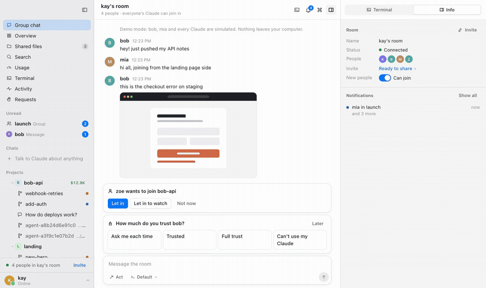
</p>

- ⚡ **Many agents at once**, each with sub-agents you can watch. The sidebar shows who's working, what's ready to merge and what needs you.
- 🧩 **Everything beside the chat**: changes and diffs, files, terminals and details in the right panel. Commit, open a pull request or merge in one click.
- 💬 **Questions stay safe**: in the main folder your agent only reads; asking for a change moves you to a new worktree.

### 🔬 Watch what your agent is making: the Scratch tab

While your agent and its sub-agents work, they save what they produce along the way to the worktree's `.beluga/scratch/` folder: screenshots of the page they just checked, test runs, logs, the JSON an API sent back, notes. The **Scratch** tab in the right panel (⌥⌘6) shows that folder live, newest first, and previews each file as it lands. Pictures show as pictures, JSON is laid out, and a log keeps scrolling while it's written. So you can see what your agent is seeing, not just what it says about it.

<p align="center">
  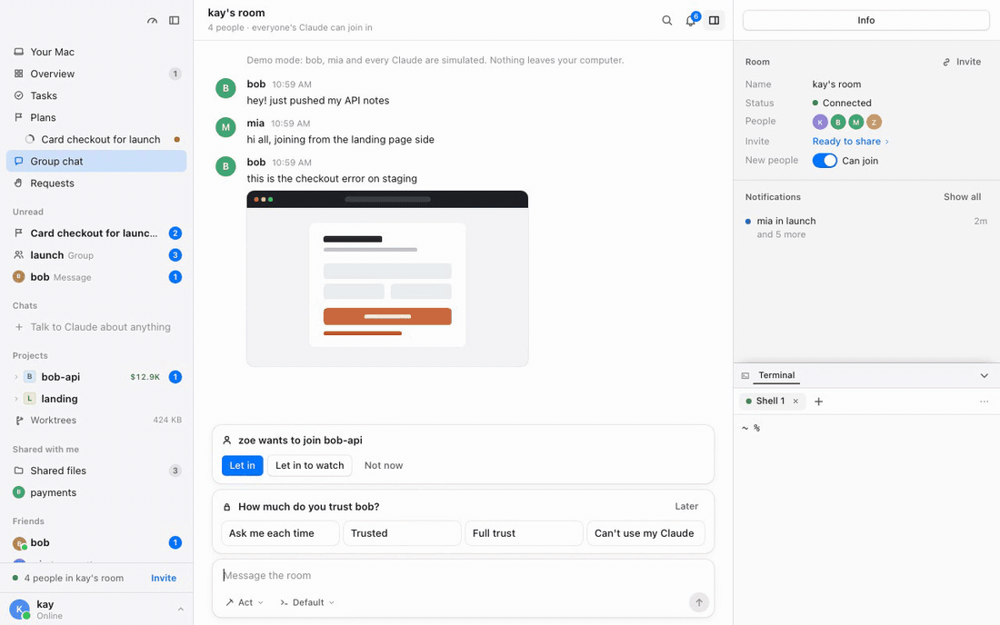
</p>

- 🖼️ **Proof, not promises**: screenshots and test results land here, and your agent attaches them to the task as proof.
- 🤖 **Per sub-agent**: each sub-agent's page has an **Outputs** tab with the screenshots, test output and files it made.
- 🙈 **Out of git**: the folder is ignored, so nothing in it ends up in a commit. **Show in Finder** opens it.

---

## Sentinel: your agent keeps watch

A **sentinel** runs when something is due or happens, does a few steps in order, and leaves a report. Every morning at seven, your agent reads what changed and writes a brief for your phone. When CI fails, your agent fixes it and opens a pull request. When Sentry sees a new error, your agent investigates, fixes it, and merges once the checks pass and you've tapped Merge. It runs on your Mac, as you, with your agent and your logins.

<p align="center">
  
</p>

- **When**: on a schedule (every day at 7:00, every Monday, every 3 hours), by hand, after another sentinel, or when something happens: a task done or a pull request opened in Beluga, a failed workflow or a new issue on GitHub, a failed payment in Stripe, a site that stops answering, a new error in Sentry, or a post to its own webhook URL.
- **Steps**: ask your agent (in the project, a fresh worktree, or Your Mac), run a script, call a service, open a pull request, merge if acceptable, notify you, message a chat, ask a friend's agent, run another sentinel.
- **Eleven recipes** to start from: Morning brief, Fix what broke, Fix it and ship it, Nightly tests, Dependency updates, Release notes, Issues to tasks, Uptime guard, Failed payments, Watch the web, Review new pull requests. Or describe what you want and your agent sets it up, here or in any chat.
- **Sentinel's dashboard**: a Keep the numbers step keeps what a sentinel found (a number, a whole series, rows, or a step's output) with each run; Sentinel's Dashboard tab picks up anything a run produced as tiles: numbers with their change since the run before, yesterday, last week or last month, series, tables, what your agent wrote, an API's answer. Describe a tile and your agent adds it, setting up a draft sentinel that fetches it when none does yet; on the Mac and the phone.
- **The Sentinel chat**: talk to the whole of Sentinel ("what did my sentinels find this week?", "watch my open pull requests"); your agent knows how Sentinel works and sees it as it is, makes and changes sentinels and tiles, and asks you before it deletes anything.
- **Safe by default**: a new sentinel starts paused. Look, Work and Ship say how far your agent may go; a merge needs green checks, a reviewer's ship and your Merge, on the Mac or the phone. Time limits, runs per day, and a pause after three failures in a row. [More](docs/sentinel.md)

---

## 👀 A real Mac app

<p align="center">
  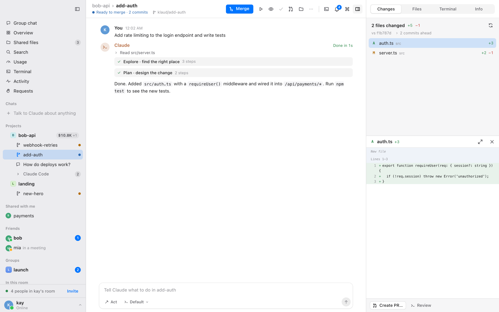
</p>
<p align="center"><sub>The conversation in the middle, the changes on the right, projects and friends on the left.</sub></p>

<p align="center">
  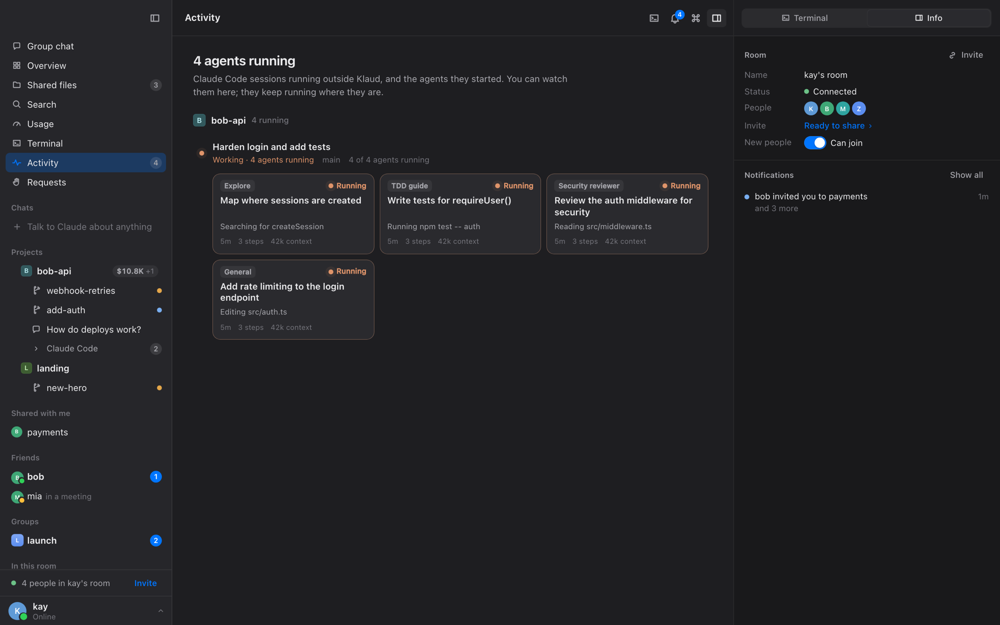
</p>
<p align="center"><sub>👀 <b>Activity</b>: every Claude Code session on your Mac (Conductor's too) and the background agents they started, live.</sub></p>

<p align="center">
  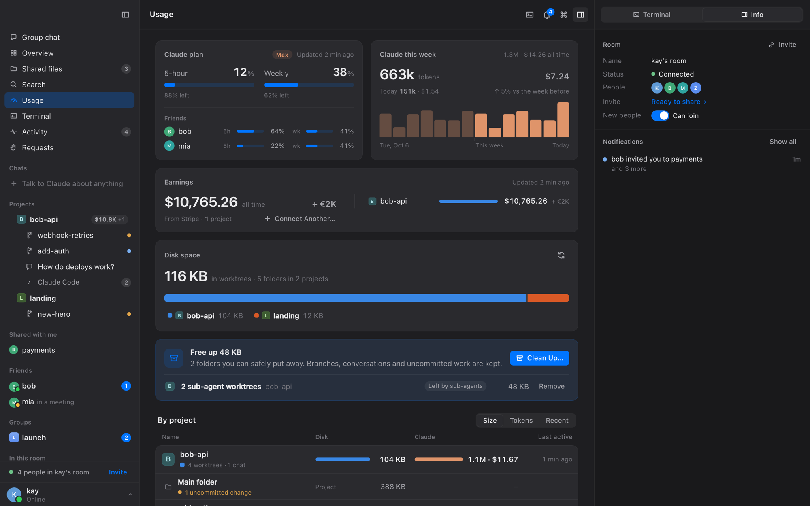
</p>
<p align="center"><sub>📊 <b>Usage</b>: your plan's limits, tokens and cost per day, disk per project with one-click clean up.</sub></p>

<details>
<summary><b>More screenshots</b></summary>
<br>
<p align="center">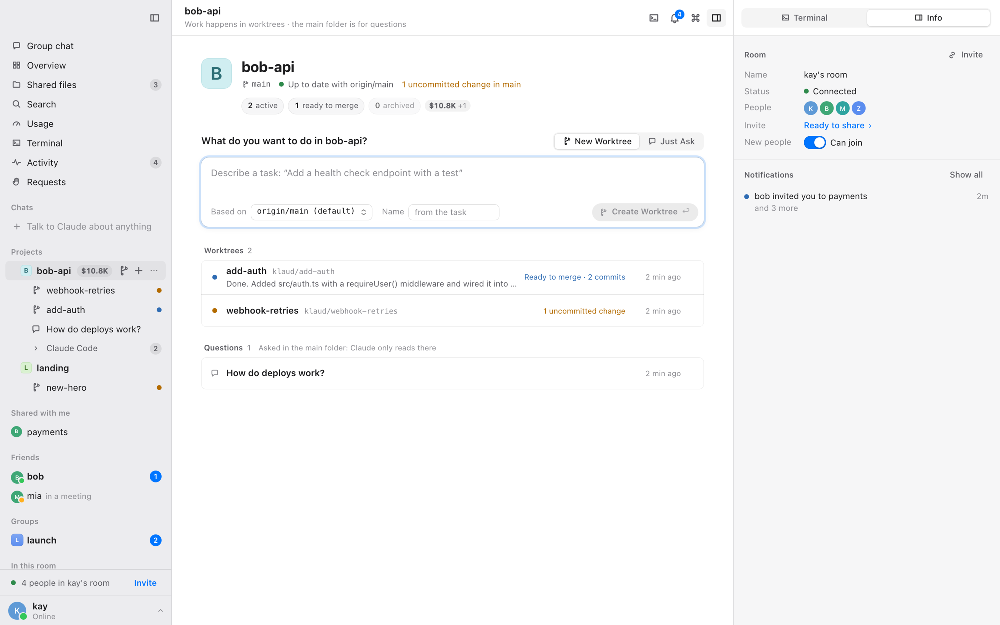<br><sub>🏠 <b>Project home</b>: describe a task and Beluga makes the worktree, or just ask about the code.</sub></p>
<p align="center">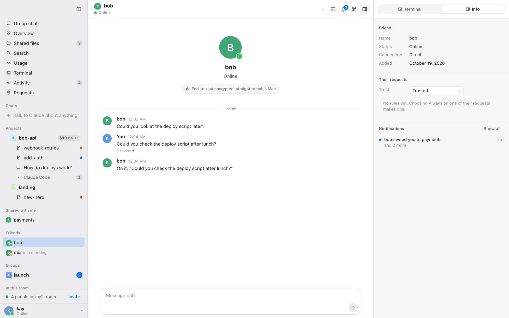<br><sub>💬 <b>Friends</b>: direct, end-to-end encrypted, no server.</sub></p>
<p align="center">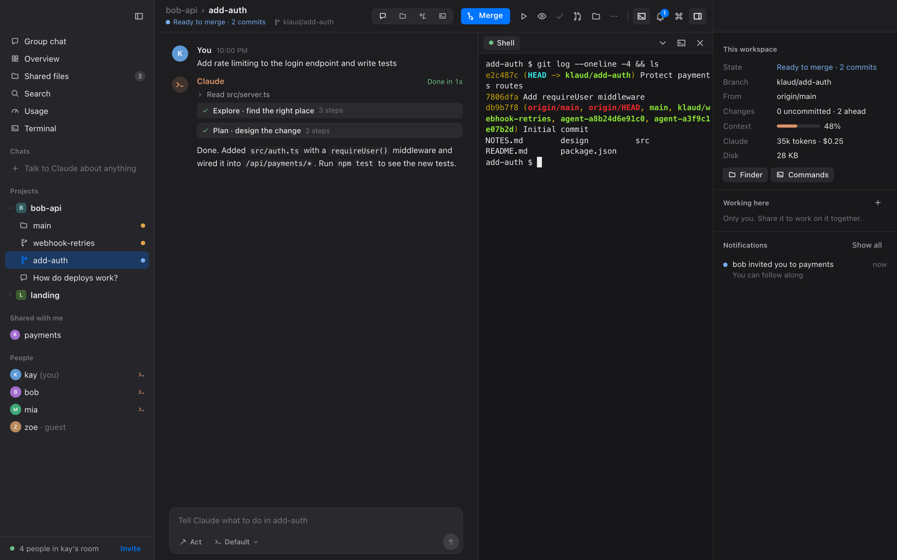<br><sub>🖥️ <b>Terminals</b> beside the chat, or in a drawer with ⌘J.</sub></p>
<p align="center">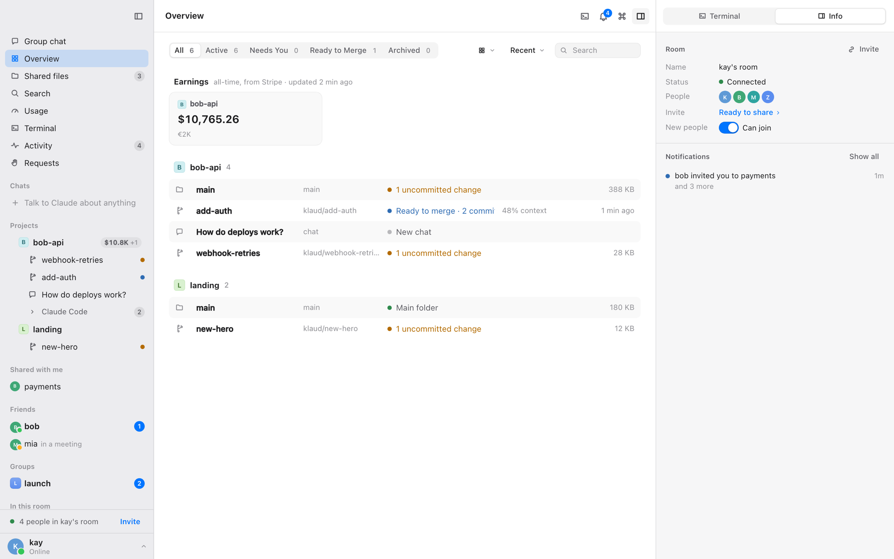<br><sub>🗂️ <b>Overview</b>: every worktree and chat, filtered by what needs you.</sub></p>
<p align="center">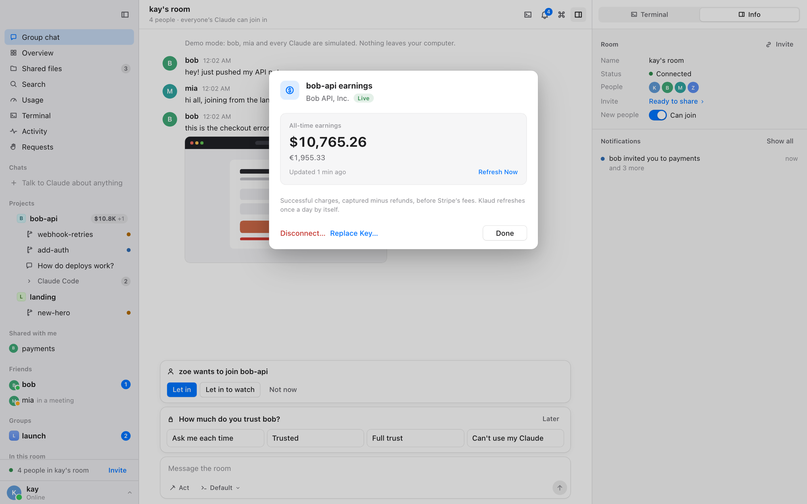<br><sub>💰 <b>Earnings</b>: a project's all-time Stripe earnings.</sub></p>
<p align="center">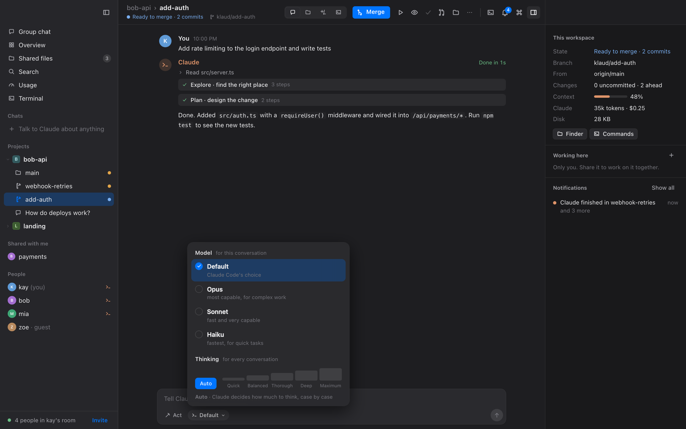<br><sub>🧠 <b>Model and thinking</b> per conversation, in plain words.</sub></p>
</details>

Light and dark, your accent colour, right-click everywhere, drag and drop, ⌘K for anything, a menu-bar icon, notifications with your own sounds, and it updates itself.

---

## 🧩 Agents

Beluga works with your agent, whichever runtime it is. Everyone's card says which agents they run and which is their default, and every message and run says whose agent did it ("mia's Codex", "your Claude").

Claude is the first supported runtime. Codex and local models are next: then `@bob` asks bob's default agent, and each worktree picks its own.

| | Claude | Codex | Local model |
| --- | --- | --- | --- |
| Worktrees, runs and sub-agents | ✅ | planned | planned |
| Beluga's tools (room, friends, views, tasks) | ✅ | planned | planned |
| Asking a friend's agent | ✅ | planned | planned |
| Plan usage in Usage | ✅ | planned | n/a |
| Sign in | Claude Code (`claude`, `/login`) | | |

## 📦 Install

1. **[Download Beluga](https://github.com/kayraucklnc/beluga/releases/latest)** for your computer:
   - **Mac:** open the `.dmg` and drag Beluga into Applications.
   - **Linux:** the `.AppImage` (make it executable, then open it; it updates itself), or the `.deb` / `.rpm` for your package manager.
   - **Windows:** run `Beluga_…_x64-setup.exe`. Windows may say it protected your PC: click **More info › Run anyway** (the installer isn't signed yet). Commands Beluga runs for you need [Git for Windows](https://git-scm.com/download/win), which Claude Code needs too.
2. On a Mac, the first time, open Beluga, click **Done** on the warning, then go to **System Settings › Privacy & Security** and click **Open Anyway** (Beluga isn't notarized by Apple yet).
   If macOS says Beluga **"is damaged"** (older downloads), run this once in Terminal, then open it again:
   ```sh
   xattr -dr com.apple.quarantine /Applications/Beluga.app
   ```
3. Sign in to your agent: for Claude, [Claude Code](https://claude.com/claude-code) (`claude`, then `/login`) if you haven't. Beluga brings everything else.
4. To work with friends: **Friends › Turn On**, then **Add a Friend** and send them the code.

## ⚙️ How it works

The engine (projects, agents, terminals, friends) runs in the background on your computer, and the app is the window onto it. Each agent runs on its owner's computer, with their own subscription; Claude runs through the [Claude Agent SDK](https://docs.claude.com/en/api/agent-sdk/overview).

More: [how it works](docs/how-it-works.md) · [security](docs/security.md) · [peer-to-peer connections](docs/p2p.md) · [the friends network](docs/network.md) · [updates](docs/updates.md) · [every action and where it is](docs/parity.md).

## 🛠️ Development

```bash
git clone https://github.com/kayraucklnc/beluga.git && cd beluga
npm install && npm test

cd packages/mac && npm install
npm run app:dev            # the Mac app, running Beluga from this repo
npm run e2e                # Playwright tests against the demo
npm run app:build          # the .app and the designed .dmg
npm run release            # build, sign and publish a release (see docs/updates.md)
node scripts/gifs.mjs      # re-record the README's GIFs (vite + the demo daemon, needs ffmpeg)
```

```
packages/mac/   the Mac app (React UI in src/, the native shell in src-tauri/)
src/            the engine (core, friends network, agents, terminals) and the app's shared models (src/ui)
docs/           guides and design notes
scripts/readme/ the README's animated diagrams (python3 scripts/readme/*.py)
```

## License

MIT
