<p align="center">
  <picture>
    <source media="(prefers-color-scheme: dark)" srcset="assets/banner-dark.svg">
    
  </picture>
</p>

<p align="center">
  <b>Every project and the Claude working in each, side by side.<br>Bring your friends: everyone brings their own Claude, and you all work together.</b>
</p>

<p align="center">
  <a href="https://github.com/kayraucklnc/klaud/releases/latest"></a>
  &nbsp;
  <a href="#klaud-in-the-terminal"></a>
</p>

<p align="center">
  <a href="#two-ways-to-use-it">Two ways to use it</a> ·
  <a href="#klaud-for-mac">Mac app</a> ·
  <a href="#klaud-in-the-terminal">Terminal app</a> ·
  <a href="#what-you-can-do">Features</a> ·
  <a href="docs/how-it-works.md">How it works</a> ·
  <a href="docs/security.md">Security</a>
</p>

<p align="center">
  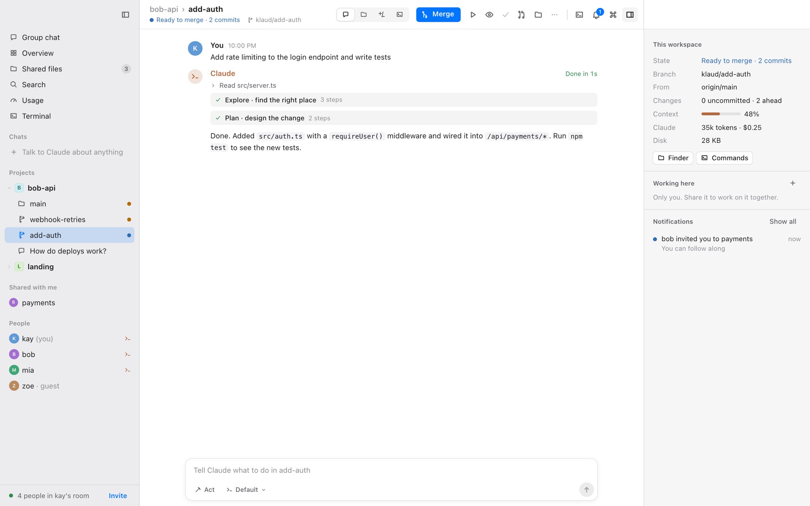
</p>

## Two ways to use it

The same Klaud, with the same projects, worktrees, Claudes and friends, in two places. Use either one, or both at once: they attach to the same Klaud underneath.

<table>
  <tr>
    <th width="50%">🖥️ Klaud for Mac</th>
    <th width="50%">⌨️ Klaud in the terminal</th>
  </tr>
  <tr>
    <td><a href="#klaud-for-mac"></a></td>
    <td><a href="#klaud-in-the-terminal">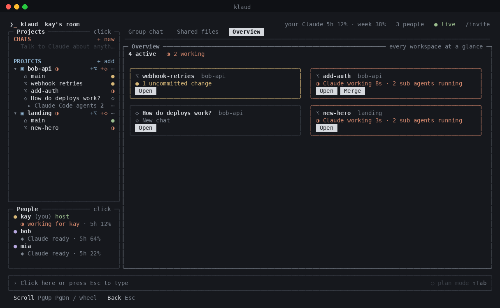</a></td>
  </tr>
  <tr>
    <td>A native Mac app: a translucent sidebar, Claude's runs as live cards, side-by-side diffs, real terminals you can dock beside the chat, images in the chat, a notification centre, friends and groups with no server. Light, dark or system.</td>
    <td>The lightweight one. Everything in your terminal, every button clickable, nothing to memorize. Perfect over SSH or when you live in the terminal.</td>
  </tr>
  <tr>
    <td><b><a href="https://github.com/kayraucklnc/klaud/releases/latest">Download the .dmg</a></b> from Releases (Apple Silicon, macOS 13+). It brings everything it needs; only <a href="https://claude.com/claude-code">Claude Code</a> must be signed in.</td>
    <td><code>npm install -g klaudcode</code> then <code>klaud</code>.<br>Needs Node 20+ and <a href="https://claude.com/claude-code">Claude Code</a> signed in.</td>
  </tr>
</table>

## What you can do

| | |
|---|---|
| 🌿 **A worktree per task, in every project** | Describe the task; a fresh worktree (its own folder, branch and Claude conversation) is made from the latest `origin`, named for you. Your `.env` files come along. |
| ⚡ **Many Claudes at once, never in each other's way** | `add-auth` in one project and `new-hero` in another work side by side, each with sub-agents you can watch live. |
| 🔭 **Everything at a glance** | Which Claude is working, which worktree is ready to merge, which has a conflict, in plain words. |
| ✅ **Review, plan, merge, pull request** | A thorough review by sub-agents; plan mode so Claude proposes before it changes anything; Merge explains itself; Claude writes the pull request. |
| 🖥️ **Real terminals** | Your own shell (zsh, bash, fish…) in every project, renamable, with your environment variables. |
| 💬 **Friends, each with their own Claude** | Invite people into a room or a single worktree. `@claude:mia` runs on mia's computer with mia's subscription. You decide how much each person may do. |
| 🔒 **End-to-end encrypted, peer to peer** | Friends connect straight to you; every message is encrypted and signed. Nothing is shared until you invite someone. |

## Klaud for Mac

**[Download it from Releases](https://github.com/kayraucklnc/klaud/releases/latest)**, open the `.dmg` and drag Klaud to Applications. The first time, right-click Klaud › **Open** (this preview isn't notarized by Apple yet).

<table>
  <tr>
    <td width="50%"><br><b>Worktrees.</b> Claude's run as a live card with its steps and sub-agents; the next step (Commit, Merge, PR) one click away.</td>
    <td width="50%"><br><b>A terminal beside the chat.</b> ⌘J docks your shell next to the conversation.</td>
  </tr>
  <tr>
    <td>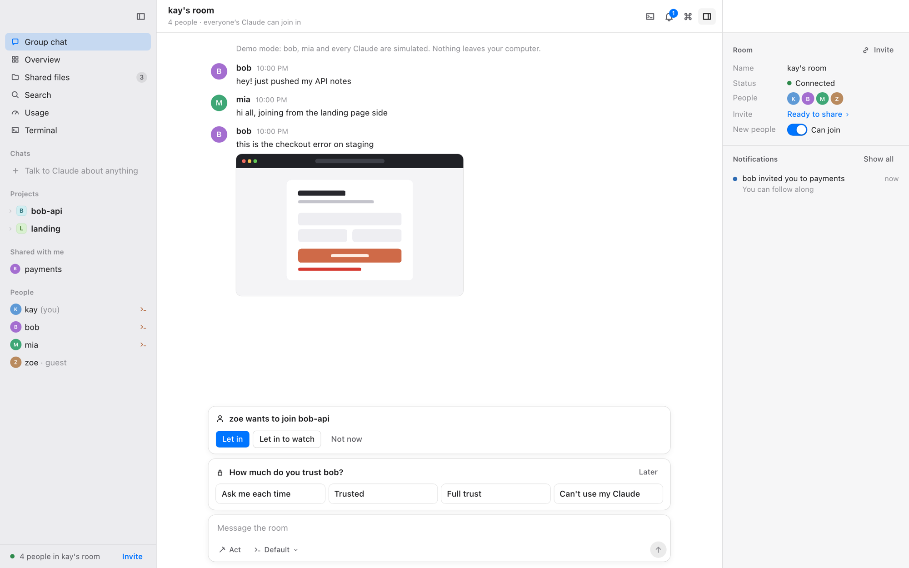<br><b>Images in the chat.</b> Paste or drop a screenshot; it shows for everyone, full size on click.</td>
    <td>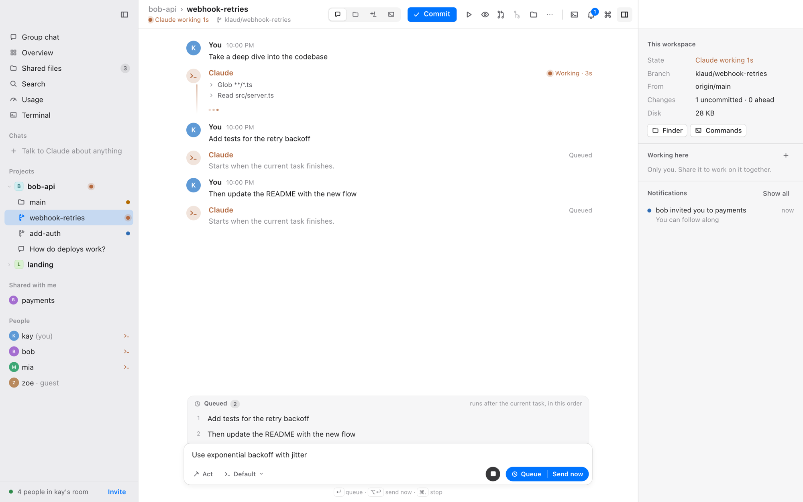<br><b>Queue or send now.</b> Keep typing while Claude works; reorder, edit or send one right away.</td>
  </tr>
  <tr>
    <td>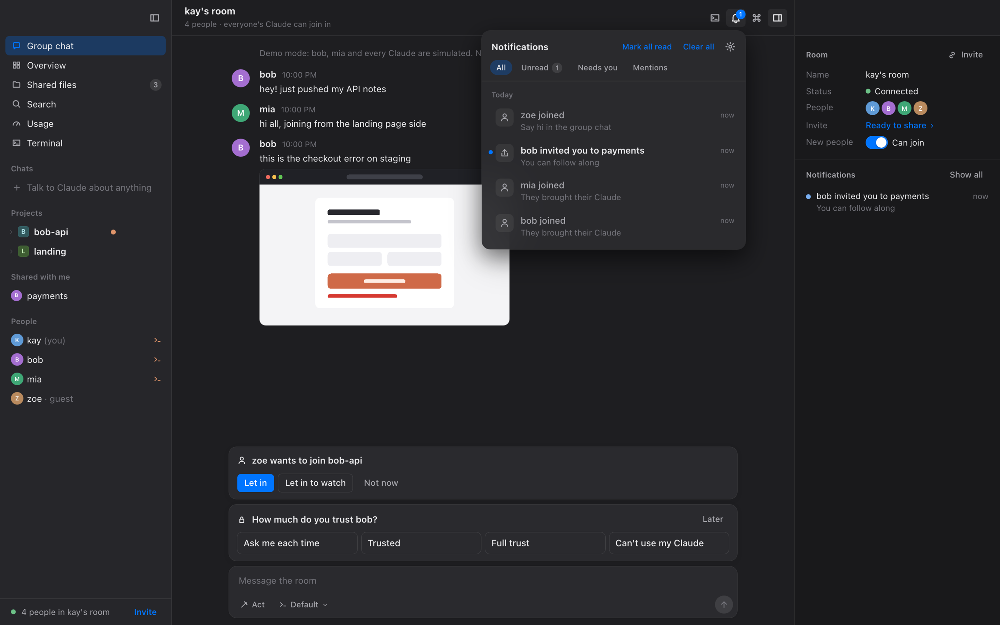<br><b>Notifications.</b> What finished or needs you, with filters, Do Not Disturb, and a click that takes you there.</td>
    <td>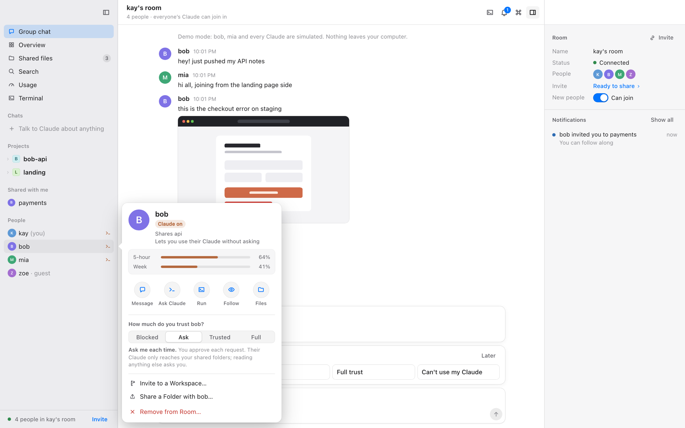<br><b>People.</b> Message someone, ask their Claude, set how much you trust them, all from their card.</td>
  </tr>
  <tr>
    <td>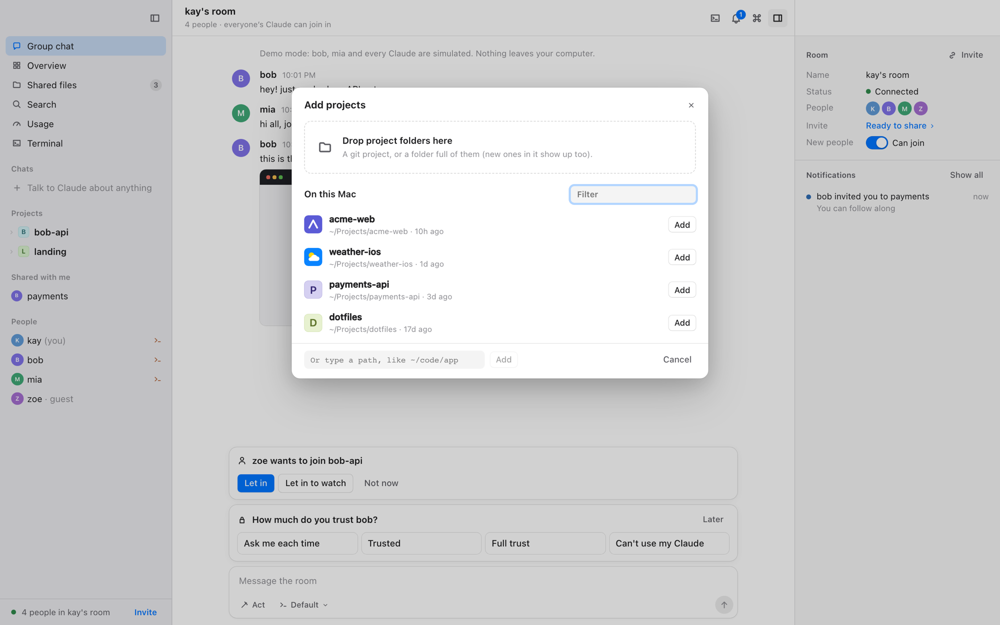<br><b>Add projects.</b> Drop folders, choose them, or pick from the git projects already on your Mac, each with its own icon.</td>
    <td><br><b>Model and thinking.</b> Pick the model for a conversation and how hard Claude thinks, in plain words.</td>
  </tr>
</table>

⌘K finds anything. Right-click works everywhere. The menu bar has every action with its shortcut, and the menu-bar icon shows what waits for you.

## Klaud in the terminal

```bash
npm install -g klaudcode   # the command it installs is `klaud`
klaud                      # your projects (nothing is shared until you click Invite)
klaud demo                 # look around with two pretend friends (npx klaudcode demo works without installing)
```

<p align="center">
  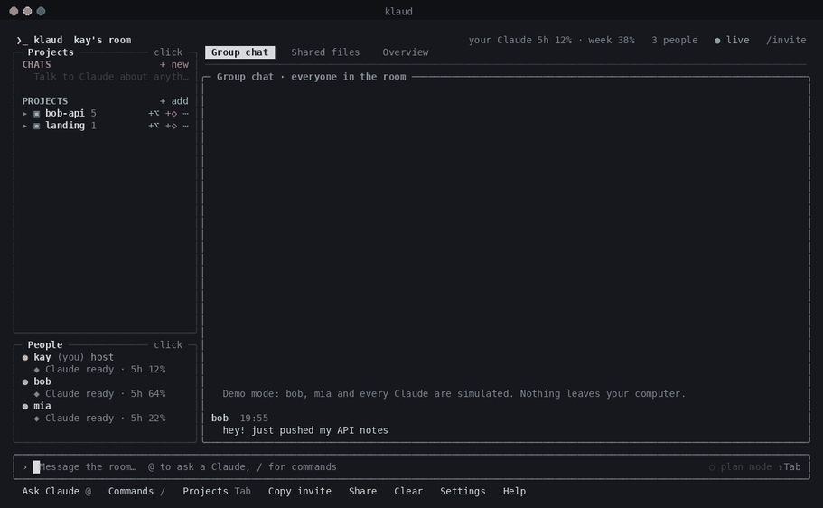
  <br><sub>Recorded with <code>klaud demo</code> (the friends and every Claude reply are simulated)</sub>
</p>

<table>
  <tr>
    <td width="50%">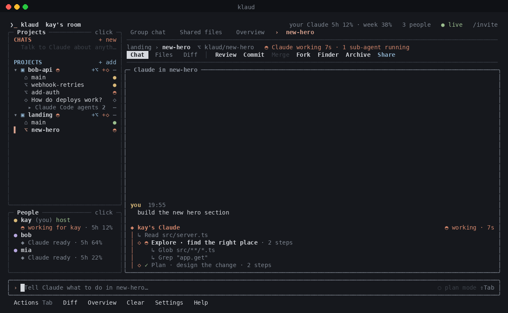<br><b>Sub-agents.</b> Explore and Plan agents working for the Claude in <code>new-hero</code>.</td>
    <td width="50%">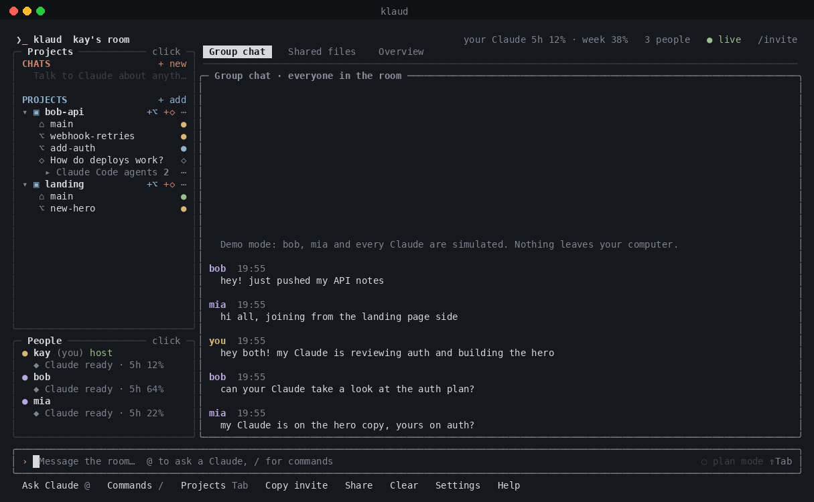<br><b>Talk with everyone.</b> You, bob and mia in one room, each with their own Claude.</td>
  </tr>
  <tr>
    <td>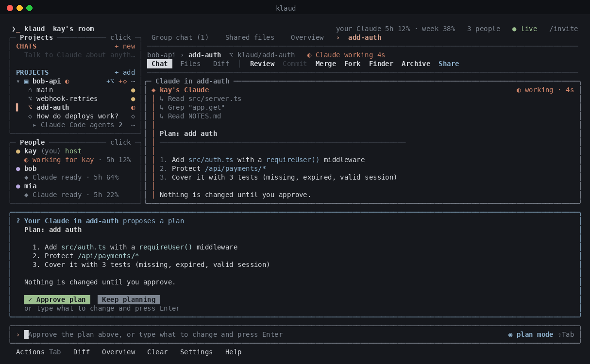<br><b>Plan first.</b> Claude looks around, then asks you to approve its plan.</td>
    <td>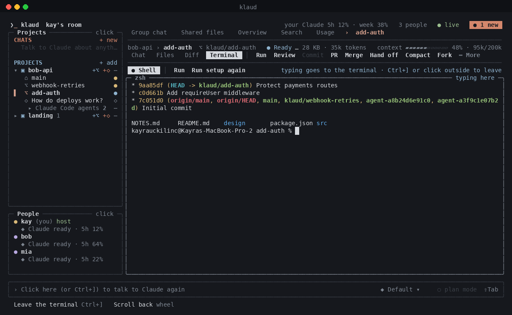<br><b>Terminal.</b> A real shell in every workspace, next to its setup and run commands.</td>
  </tr>
</table>

Everything is clickable, and the bar at the bottom always says what you can do next. The full guide: **[docs/terminal.md](docs/terminal.md)**.

## Working with friends

Click **Invite** and send the link. Your friends open it in Klaud for Mac, or run `klaud join <link>` in the terminal. Everyone keeps their own Claude, subscription and permissions:

- `@claude:mia` asks mia's Claude; it runs on mia's computer.
- Share one worktree to build it together, or hand it off so their Claude continues it.
- When someone joins, pick how much you trust them: *Can't use my Claude*, *Ask me each time*, *Trusted*, or *Full trust*.

Friends connect straight to you, peer to peer, end-to-end encrypted ([how](docs/how-it-works.md), [security](docs/security.md)).

## How it works

Klaud is one engine with two faces. The engine (projects, Claude, terminals, rooms) runs in the background on your Mac; the Mac app and the terminal app are both windows onto it, so approving something in one clears it in the other. Each Claude runs on its owner's computer through the [Claude Agent SDK](https://docs.claude.com/en/api/agent-sdk/overview).

More: [how it works](docs/how-it-works.md) · [security](docs/security.md) · [peer-to-peer connections](docs/p2p.md) · [the friends network](docs/network.md) · [what each app offers](docs/parity.md).

## Development

```bash
git clone https://github.com/kayraucklnc/klaud.git && cd klaud
npm install
npm run dev -- demo        # the terminal app, from source
npm test                   # unit, multi-peer and two-screen tests
npm run typecheck
```

The Mac app lives in [packages/mac](packages/mac) (Tauri 2, React):

```bash
cd packages/mac && npm install
npm run app:dev            # the app, running Klaud from this repo
npm run dev                # just the web UI in a browser (start a daemon first: klaud daemon --keep-alive demo)
npm run e2e                # Playwright tests against the demo
npm run app:build          # bundles Node + Klaud, then the .app and .dmg
```

```
src/            the engine (core, network, Claude, terminals) and the terminal app (src/ui)
packages/mac/   the Mac app (React UI in src/, the native shell in src-tauri/)
docs/           guides and design notes
```

Every merge to `main` publishes the terminal app to npm and the Mac app to Releases ([publish.yml](.github/workflows/publish.yml)).

Klaud used to be called klaude. Your `~/.klaude` settings, projects and worktrees carry over automatically.

## License

MIT
