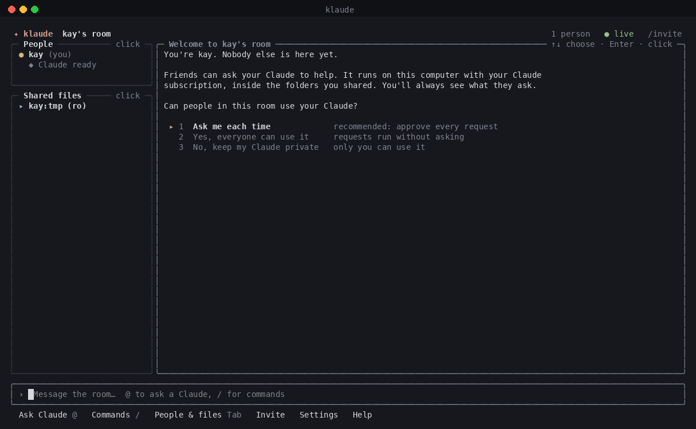
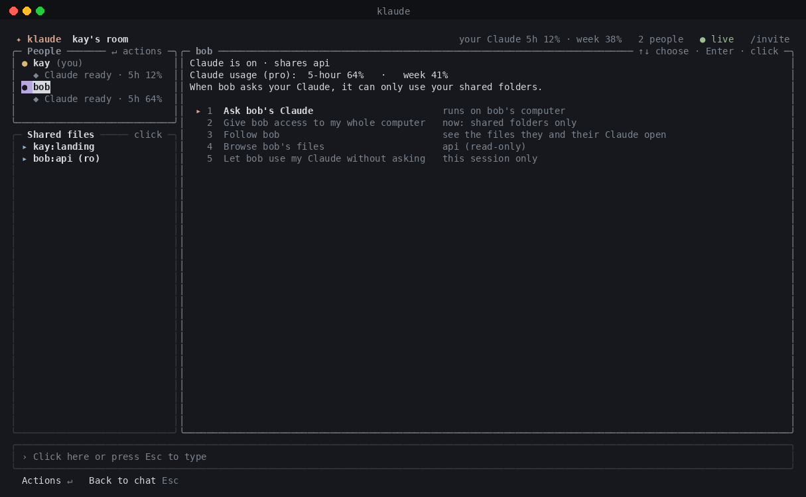
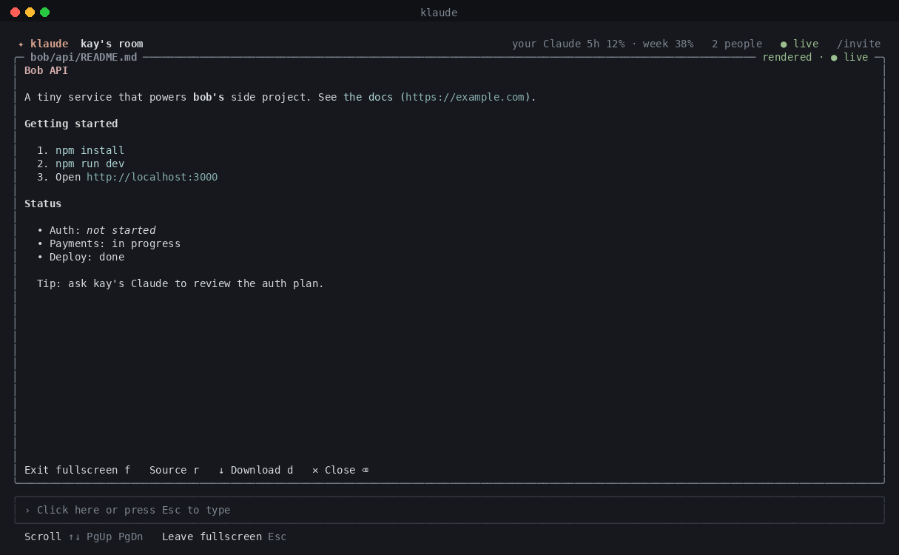
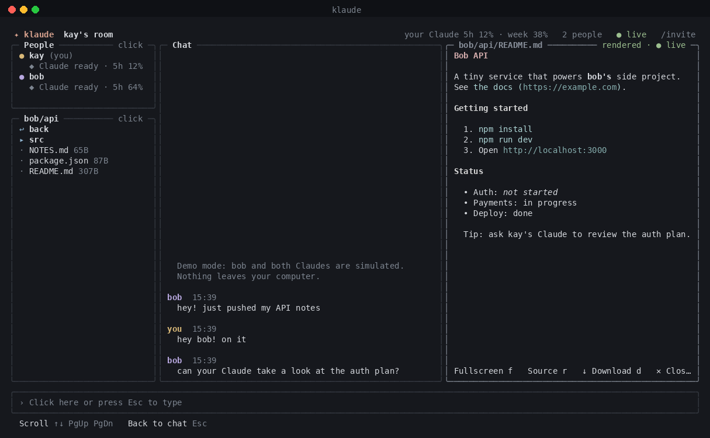

<p align="center">
  <picture>
    <source media="(prefers-color-scheme: dark)" srcset="assets/banner-dark.svg">
    
  </picture>
</p>

<p align="center">
  <a href="#quick-start"><b>Quick start</b></a> ·
  <a href="#what-you-can-do"><b>Features</b></a> ·
  <a href="#how-it-works"><b>How it works</b></a> ·
  <a href="#security"><b>Security</b></a>
</p>

<p align="center">
  
  <br><sub>Recorded with <code>klaude demo</code> (the friend and Claude replies are simulated)</sub>
</p>

## What you can do

| | |
|---|---|
| 💬 **Group chat with Claude in it** | Talk with friends, and type `@claude` to bring your Claude in. Everyone watches it work live. |
| 🤝 **Ask a friend's Claude** | `@claude:bob` runs on **bob's** computer with **bob's** subscription, after bob approves. |
| 📂 **Browse and download shared folders** | Click through a friend's shared folder, read files (Markdown is formatted), and download securely. |
| 👀 **Follow along** | Follow a friend, Google Docs style: your viewer jumps to whatever they or their Claude open. |
| 🔒 **Private by design** | End-to-end encrypted. You decide who can use your Claude, and which folders it can touch. |
| 🌍 **Works from anywhere** | Free encrypted Cloudflare tunnel with no account and nothing to configure. |

## Quick start

```bash
git clone https://github.com/kayraucklnc/klaude.git && cd klaude
npm install && npm run build && npm link
```

| You | Your friend |
|---|---|
| `klaude` starts a room and copies the invite | copy the invite, then run `klaude join` |

Want to look around first? **`klaude demo`** opens a room with a pretend friend and simulated Claude replies.

You need Node 20+ and [Claude Code](https://claude.com/claude-code) signed in (`claude`, then `/login`).

## A quick tour

<table>
  <tr>
    <td width="50%"><br><b>Welcome.</b> Choose who can use your Claude.</td>
    <td width="50%"><br><b>Ask anyone's Claude.</b> Live steps, then a clear answer.</td>
  </tr>
  <tr>
    <td><br><b>Click a person.</b> Ask their Claude, follow them, browse their files, set their access.</td>
    <td><br><b>Read files formatted.</b> Fullscreen, source view, and download are one click away.</td>
  </tr>
  <tr>
    <td><br><b>Shared files.</b> Browse friends' folders; files update live.</td>
    <td><br><b>Settings.</b> Name, theme, sharing, mouse and remote access, all remembered.</td>
  </tr>
</table>

Everything is clickable. The bar at the bottom always shows what you can do next, so there are no shortcuts to memorize.

---

## Using klaude

### Talking

| Type | What happens |
|---|---|
| `hey all` | message everyone |
| `@claude fix the failing test` | your Claude, on your computer |
| `@claude:bob how does auth work?` | bob's Claude, on bob's computer, after bob approves |
| `@claudes review this plan` | every Claude in the room at once |

Type `@` or `/` and suggestions appear: Tab or Enter picks one. Claude's progress shows as a live card with its steps and a formatted answer.

Each Claude also gets **room tools**: post to the chat, see who's here, ask another person's Claude (agent to agent), read a friend's shared files, and write a Markdown report that everyone can open.

### Commands

| Command | |
|---|---|
| `/invite` | copy the invite link |
| `/open bob:api/README.md` | open a shared file (autocompletes as you type) |
| `/get bob:api/data.csv` | download a file to `~/Downloads/klaude/bob/` |
| `/follow bob` · `/unfollow` | follow bob and bob's Claude |
| `/copy` | copy the last Claude answer |
| `/settings` | name, theme, sharing, mouse, remote access |
| `/name kay` · `/theme mono` | quick changes |
| `/policy ask\|auto\|deny` | who can use your Claude |
| `/trust bob` · `/untrust bob` | let bob skip approval for this session |
| `/stop` · `/people` · `/clear` · `/help` · `/quit` | |

### Keys (all optional, since everything is also clickable)

| Key | |
|---|---|
| `Enter` | send, or accept the highlighted suggestion |
| `Tab` / `Shift+Tab` | complete a suggestion, or move between chat, people, files and viewer |
| `Esc` | back to chat |
| `↑ ↓` · `PgUp PgDn` | history or suggestions · scroll |
| `f` · `r` · `d` (in the viewer) | fullscreen · source/formatted · download |
| `Ctrl+Y` · `Ctrl+N` · `Ctrl+T` | allow · deny · always allow this person |
| `Ctrl+C` twice | quit |

### Settings

Your choices are saved in `~/.klaude/settings.json`, so plain `klaude` always starts the way you like it. Open **Settings** from the bottom bar or with `/settings`:

- **Name**: what friends see
- **Color theme**: Calm (dark), Light terminal, High contrast, Monochrome
- **Who can use my Claude**: ask each time, everyone, or nobody
- **Mouse clicks**: turn off to get your terminal's native text selection back
- **Remote access**: Cloudflare (default), ngrok, or local network only
- **Text size** belongs to your terminal: `⌘ +` / `⌘ −`

### Command line

```
klaude                           start a room with your saved settings
klaude join [invite]             join a room (reads the invite from your clipboard)
klaude demo                      try everything alone

  -n, --name <name>        display name (remembered)
  -s, --share <spec>       share a folder: [name=]path[:rw], repeatable
      --no-share           share nothing (default: the current folder, read-only)
      --no-agent           don't offer your Claude
      --policy <p>         ask | auto | deny
      --tunnel <kind>      auto | cloudflared | ngrok | none
      --no-mouse           keyboard only
      --model <id>         model for your Claude
```

## How it works

```
 your computer                                       bob's computer
┌──────────────────────────────┐                   ┌──────────────────────────────┐
│ klaude                        │   encrypted       │ klaude                        │
│  chat · files · approvals     │◄─── frames ──────►│  chat · files · approvals     │
│  your Claude (your login)     │  via Cloudflare   │  bob's Claude (bob's login)   │
│  room hub (relay)             │                   │                               │
└──────────────────────────────┘                   └──────────────────────────────┘
```

- **Room hub**: a tiny relay on the host's computer. It checks the invite secret, relays messages, and keeps a short history for late joiners.
- **End-to-end encryption**: every message is sealed with AES-256-GCM using a key derived from the invite, so the tunnel only ever sees ciphertext.
- **Each Claude runs at home**: the [Claude Agent SDK](https://docs.claude.com/en/api/agent-sdk/overview) drives each person's own Claude Code, with their own subscription and their own permissions.
- **Plan usage**: everyone's 5-hour and weekly limits show next to their name.

## Security

- **The invite is the key.** Anyone with it can join. Start a new room to revoke access.
- **You approve requests.** Friends can't run your Claude unless you allow it (each time, for one person, or for everyone).
- **You set the reach.** Per friend: *shared folders only* (the default; everything else is blocked) or *whole computer*.
- **Risky actions always ask.** Every shell command, web request and edit outside a `:rw` folder needs your OK, even ones Claude Code would normally auto-approve.
- **Secrets stay put.** `.env` files, keys, `.ssh`, `.aws` and similar are never shared or readable by agents.
- **Fair use.** Each person uses their own Claude account. Nothing is shared between machines except chat, files you share, and results.

## Development

```bash
npm install
npm run dev -- demo        # run from source
npm test                   # 160+ unit and multi-peer integration tests
npm run typecheck
```

## Roadmap

- **Projects and workspaces**: auto-detect projects; spin up a git worktree per task from `origin`; review, merge, fork, and archive from the app; per-workspace Claude conversations
- Share a project or a single workspace with friends; invite them into its chat
- Show sub-agents nested under Claude's card
- Inline images in the viewer

## License

MIT
